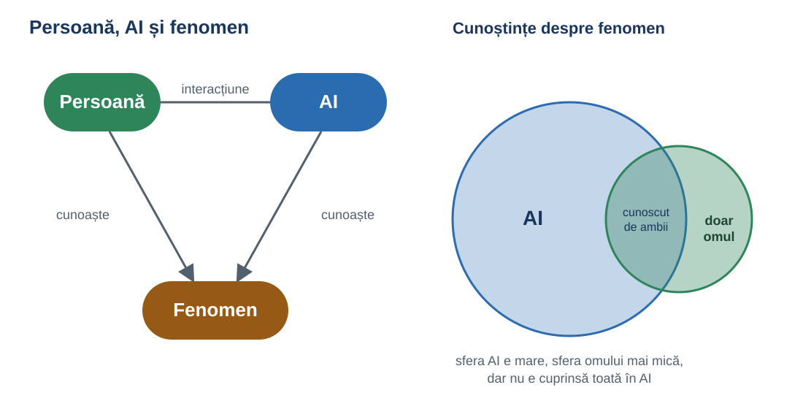
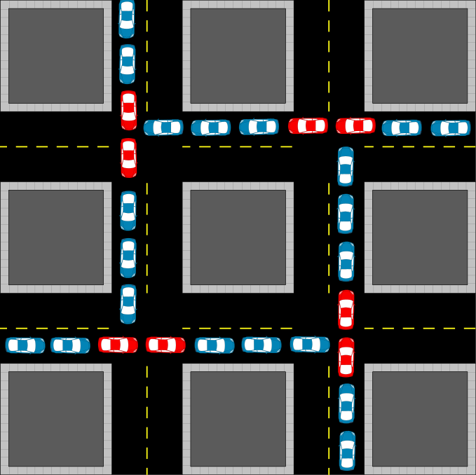
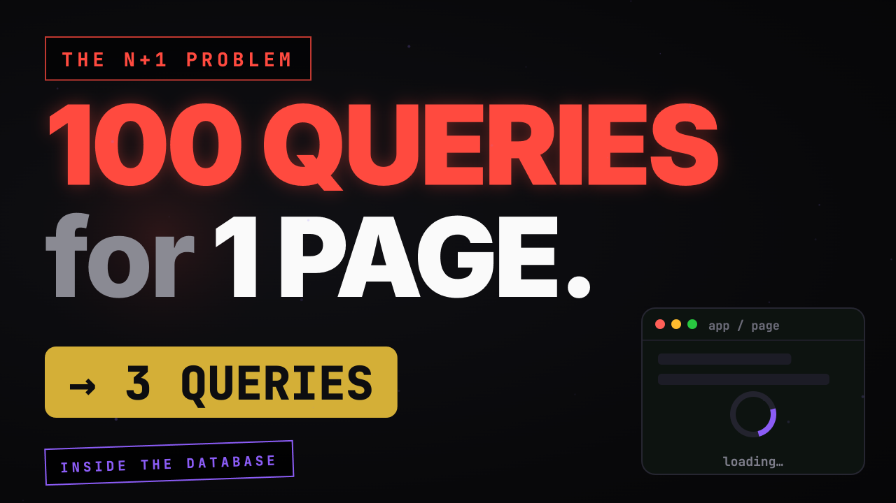
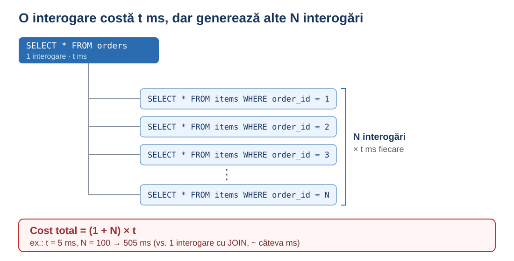
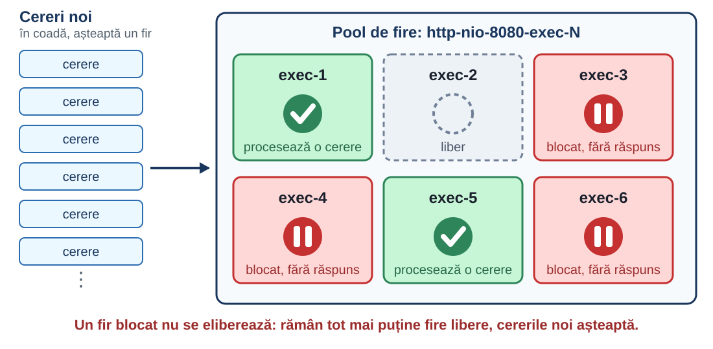
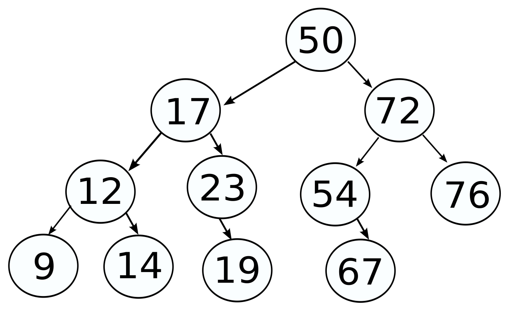
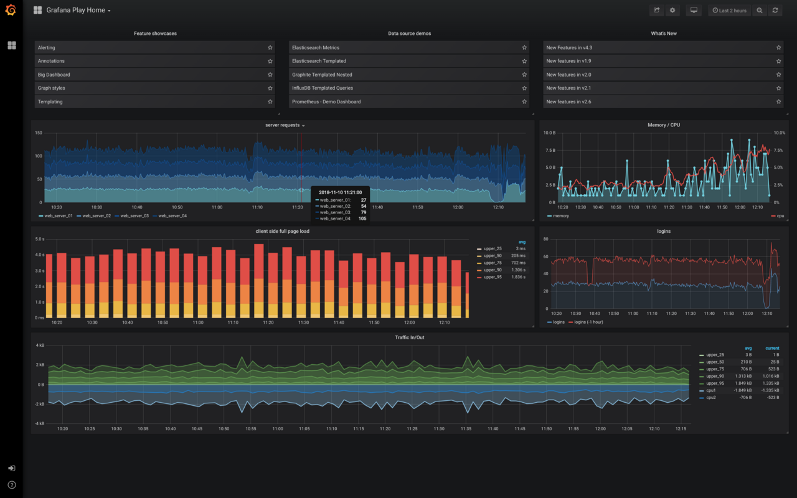

<!-- _class: title -->
<!-- _paginate: false -->

# Navigating Complexity with GenAI

**Radu Dumbrăveanu**
Bălți · BitConf 2026


---

<!-- _class: motto -->
<!-- _paginate: false -->

> There has never been a more interesting time to think than in the age of AI.

Niciodată nu a fost mai interesant să gândești decât în epoca inteligenței artificiale.

<!--
Variantă de traducere: Nu a existat niciodată un moment mai interesant pentru gândire decât cel pe care îl trăim acum, în plină revoluție AI.
-->

---

# Prin complexitate mă refer la:

- sisteme / fenomene / probleme cu mulți factori interconectați
- granițe neclare între factori
- combinații greu de prevazut exhaustiv
- și situații care doar par complexe (formulă sau perspectivă)

<!-- 
Prin complexitate mă voi referi la situații, sisteme, fenomene, probleme, care constau din mai mulți factori
(variabile, componente) interconectate astfel încât este greu să tragi o graniță clară între ei și e greu să
prevezi toate combinațiile posibile ale acestora. 
La fel, prin complexitate mă voi referi și la situațiile care
par așa (adică par complexe la prima vedere) fie din cauza formulării, fie din cauza subiectului care abordează
situația.
-->

---

# Wayfinder (Matt Pocock)

- început dificil: formulare neclară sau primii pași costisitori
- Wayfinder pune întrebări, construiește lanțul de pași, ține evidența
- AI execută pașii tehnici (librării, programe) în câteva minute
- eu rulez, văd rezultatele, analizez
- generalizare: **gradul de finețe în interacțiunea cu AI**
  - înlocuiesc prezentarea tuturor opțiunilor cu prezentarea opțiune cu opțiune

<small>Sursa: https://github.com/mattpocock/skills/tree/main/skills/engineering/wayfinder</small>

<!--
Primul exemplu: situațiile când suntem la început, și fie avem o formulare la care chiar dacă o citim de 10 ori nu știm de unde să începem și încotro să ne ducem, sau pașii inițiali necesită mult efort.

În așa situație am o experiență foarte bună cu un instrument public, Wayfinder, de Matt Pocock. Instrumentul pune întrebări, pe baza răspunsurilor definește un lanț de pași și memorează care pas l-ai executat și care mai ai. Îl utilizez și când citesc un articol tehnic cu fragmente de cod de executat, sau care discută algoritmi: cu Wayfinder îmi definesc pașii care îmi trebuie; pașii care presupun instalare de librării și scriere de programe sunt executați de AI în câteva minute, iar eu pot rula programele, vedea rezultatele și analiza. Astfel pot analiza și scoate concluziile dintr-un articol complicat foarte repede.

Metoda se poate generaliza în „gradul de finețe în interacțiunea cu AI”; ambele cuvinte sunt importante: „finețe” (cât de fină vs grosieră) și „interacțiune”.
-->

<!-- TODO desen: wayfinder nu e clar (unealta ta?), de ales împreună -->

---

# AI e foarte bună la enumerare

- întrebări la care nu m-am gândit
- riscuri și cazuri limită
- alternative și variante
- ipoteze ascunse
- criterii de comparare
- ce aș putea să fi uitat
- exemple și contraexemple

<!--
AI e foarte bună la enumerare: întrebări la care nu m-am gândit, riscuri, variante, ipoteze ascunse, criterii de comparare. Umple lista cu elemente apropiate semantic și îmi arată zone la care nu m-aș fi gândit singur. Eu aleg ce are sens și verific.
-->

---

# Cere și explicația vizuală de la AI

- articol: „How to 5x your communication effectiveness with Claude Code” (Towards Data Science)
- agentul scrie rezultatele netriviale ca fișier HTML, deschis în browser, nu ca text în terminal
- instrucțiunea se pune o dată, în fișierul MD la nivel de utilizator
- skill-uri pentru sarcini concrete (ex. raport de teste)
- Archify pentru diagrame
- concluziile apar la final, rezultatul e prezentat vizual

<!--
Exemplul precedent arăta că deseori e binevenit să începem abordarea complexității cu AI. Aici vorbesc despre etapele intermediare, sau chiar etapa finală, și mai ales despre prezentarea rezultatelor.

Am întâlnit un articol foarte interesant exact în momentul când obosisem să citesc răspunsurile de la AI. Metoda din articol (agentul scrie rezultatul netrivial ca fișier HTML, deschis în browser, în loc de text în terminal) accelerează înțelegerea: pune concluziile la final și prezintă rezultatul vizual. Instrucțiunea merge o singură dată într-un fișier MD la nivel de utilizator; pentru sarcini concrete (ex. raport de teste) se folosesc skill-uri, iar pentru diagrame Archify.

Generalizare: „Cere și explicația vizuală de la AI”.

Sursa: https://towardsdatascience.com/how-to-5x-your-communication-effectiveness-with-claude-code/
-->

---

# Obiecție: delegăm totul AI?

- problemele simple, de rutină, le delegăm deja
- AI se descurcă bine și cu cele complexe
- deci de ce nu delegăm întreaga complexitate?
- fără skill-uri, fără formate de prezentare: dăm problema, luăm răspunsul

<!--
Mulți ar putea obiecta și spune că putem delega întreaga complexitate către AI, fără skill-uri sau formate de prezentare. Dacă AI rezolvă bine problemele simple, de ce să nu delegăm și cele complexe?
-->

---

# Răspunsul: modelul mental

- pentru a înțelege un fenomen, îți trebuie un model mental al lui
- sarcini simple: modelul mental există deja, nu pierdem nimic
- sarcini complexe: delegându-le, pierdem șansa să ne formăm modelul
- formarea modelului mental necesită timp
- noi decidem: ne trebuie modelul sau nu? (raportul timp:rezultat cu AI e foarte bun)

<!--
Concluzia mea e simplă, pentru a înțelege un fenomen îți trebuie un model mental al acestui fenomen.
Delegând sarcinile simple către AI, pentru care avem deja modele mentale formate nu pierdem nimic.
Delegând însă sarcinile complexe către AI pierdem șansa să ne formăm modelul mental.
Însă formarea modelului mental necesită timp.
Deja noi trebuie să decidem, ne trebuie oare acest model mental sau nu, pentru că raportul timp:rezultat atunci când folosești AI e foarte bun.
-->

---

# De ce îți trebuie modelul mental?

- fenomenul complex trebuie abordat astfel încât să abordezi ușor alte fenomene din aceeași familie
- raportul timp:rezultat nu e suficient, contează și calitatea rezultatului
- rezultatul poate să nu fie optim (multe iterații): trebuie să schimbi cum abordează AI problema
- rezultatul poate să nu fie corect (AI e non-deterministă): îți trebuie subrezultate deterministe
- ambele cer mai mult decât un model superficial al fenomenului

<!--
Fenomenul complex trebuie abordat astfel încât să poți ușor aborda orice alte fenomene complexe din aceeași familie.

Însă concentrându-mă pe raportul timp:rezultat nu întotdeauna suficient. Mai apare și dimensiunea calității rezultatului:
1. rezultatul poate să nu fie optim (sau poate să facă multe iterații), și atunci cel mai des îți trebuie să schimbi felul în care abordează AI problema, dar pentru acesta un model superficial al fenomenului nu e suficient
2. rezultatul poate să nu fie corect din cauza naturii non-deterministe a AI și pentru acesta îți trebuie subrezultate deterministe, la care iarăși nu ajungi cu modele superficiale ale fenomenului.
-->

---

<!-- _class: img -->
<small>Sursa: Reddit, r/ChatGPT · <a href="https://www.reddit.com/r/ChatGPT/comments/1kbj71z/i_tried_the_create_the_exact_replica_of_this/" target="_blank">deschide postarea</a></small>

<small>I tried the "Create the exact replica of this image, don't change a thing" 101 times, but with Dwayne Johnson</small>

<video src="the_rock_mutating.mp4" controls loop style="height:580px;max-width:1180px;border-radius:8px;background:#000"></video>

---

# Cum abordăm fenomenele complexe?

- lume complexă: participă, în măsură diferită, și omul, și AI
- întrebarea: cum să le avem pe toate?
- rapid
- cu înțelegere
- ...

<!--
(Deci trăind într-o lume complexă, e nevoie ca să participe într-o anumită măsură și omul și AI.)

Întrebarea importantă cum să abordăm fenomenele complexe astfel încât să le avem pe toate: rapid, înțelegere etc...
-->

---

# Al treilea participant: modelul (fenomenul)

- am observat o polarizare: de o parte omul, de cealaltă AI
- al treilea participant: **modelul** (fenomenul)
- model mental, model software, cadru științific, cunoștințe, ...
- sunt la îndemână: le putem folosi direct, fără AI

<!--
Eu mi-am răspuns la această întrebare. Răspunsul e subiectiv dar e următorul:

În realitatea actuală, am observat o polarizare: într-o parte omul, în altă parte AI. Eu am să numesc al treilea participant modelul (fenomenul).
Modelul poate fi mental, poate fi model software, poate fi cadrul științific, cunoștințele ... la care avem acces direct, nu ne trebuie AI.
-->

---

<!-- _class: img -->



---

# Regula mea

- întâi: poate modelul fenomenului „să rezolve” problema cu efort minim?
- dacă pot amândoi (modelul fenomenului și AI), nu folosim AI
- folosim AI pentru că poate, dar nu e singurul participant care poate: poate și modelul

<!--
Regula mea este următoarea. Mă întreb cine poate rezolva problema cu efort minim: modelul fenomenului sau AI. Dacă pot amândoi, nu folosim AI.

De aceea, întâi trebuie să ne gândim: e posibilă oare o abordare în care modelul fenomenului depune un efort minim?

Noi folosim AI pentru că poate, dar mai există și alți participanți care pot, ca de exemplu modelul.
-->

---

# Exemplu: deadlock (interblocare)

- din experiența mea: eroarea „nu mai sunt conexiuni pentru baza de date”
- mai multe procese gestionează resurse, printre care și conexiunile la baza de date, luate dintr-un pool de conexiuni (număr limitat)
- procesul A ține o conexiune și mai cere o resursă
- resursa e ocupată de procesul B
- B, înainte să o elibereze, are nevoie de o conexiune la baza de date
- fiecare așteaptă după altul: nimeni nu mai înaintează

<!--
Un exemplu din experiența mea: în anumite momente apărea eroarea că nu mai sunt conexiuni pentru baza de date. Ce se întâmpla de fapt: mai multe procese gestionau resurse, printre care și conexiunile la baza de date, care veneau dintr-un pool de conexiuni, deci în număr limitat. Uneori un proces cere o conexiune la baza de date și, înainte de a o elibera, mai cere o resursă, dar aceasta e ocupată de alt proces care, înainte de a o elibera, are nevoie de o conexiune la baza de date.
-->

---

<!-- _class: img -->
<small>Sursa desenului: https://commons.wikimedia.org/wiki/File:Gridlock.svg</small>



---

# Deadlock: de ce e greu de studiat

- mulți utilizatori: sistem greu de depanat
- puțini utilizatori: ușor de depanat, dar greu de reprodus

<!--
Este destul de complicat de depanat sistemul când avem mulți utilizatori, dar în cazul când ai un număr mic de utilizatori, e ușor de depanat, dar e mai greu de reprodus.
-->

---

<!-- _class: img -->
<small>Simulare generată de Claude: pool de conexiuni, micșorat de la 10 la 1 · <a href="connection_pool_deadlock.html" target="_blank">deschide direct</a></small>

<iframe src="connection_pool_deadlock.html" style="width:1180px;height:580px;border:0;border-radius:8px;background:#fff"></iframe>

---

# Deadlock N=1 vs. AI

- la N=1 fenomenul converge singur spre starea dorită: problema se reproduce și e ușor de studiat
- alt exemplu: OOM
  - uneori sistemul afișează mesajul `OutOfMemory`
  - soluție: micșorăm memoria totală și eroarea se reproduce mult mai repede
  - astfel se vede mai clar cauza: cine cere multă memorie sau cine ocupă prea multă memorie

<!--
La N=1 fenomenul însăși converge către starea dorită, se reproduce problema și e ușor de studiat.

Alt exemplu OOM: uneori un sistem afișează mesajul OutOfMemory. Soluție: dacă micșorăm memoria totală, vom reproduce eroarea mult mai repede și se va vedea mai clar cauza: cine cere multă memorie sau cine ocupă prea multă memorie.
-->

---

# Deadlock: cazul particular în locul celui general

- nu am delegat problema către AI
- în loc de problema generală, am luat un caz particular, mai simplu (N=1, memorie mică)
- cazul particular s-a dovedit mai ușor de reprodus și de studiat
- prin el am găsit soluția și pentru problema generală

<!--
Nu am delegat problema către AI. În loc de problema generală am luat un caz particular, care s-a dovedit mai simplu, și prin care am găsit soluția și pentru problema generală.
-->

---

# Exemplu: problema N+1

- din experiența mea, la o problemă de performanță primul lucru de verificat: nu cumva e problema N+1?

<!--
Foarte des când avem problemă de performanță primul lucru ar trebui să verificăm, sunt probleme N+1.
-->
---

<!-- _class: img -->
<small>Sursa desenului: https://dev.to/dilip_v_p/the-n1-query-problem-how-one-page-fires-2101-queries-and-how-to-get-back-to-3-3l3i</small>



---

<!-- _class: img -->



---

# Exemplu: problema N+1 – metoda

- presupunem: fără bibliotecă care o detectează, dar cu acces la jurnalul de SQL-uri
- foarte multe interogări, mai ales cu mulți utilizatori
- clase de echivalență după numărul de repetări ale interogării: `[1]` excludem, `[2]`, `[3]`... ne interesează
- am construit o altă problemă, care se rezolvă simplu și se studiază ușor
  - putem delega către AI să extragă clasele, sau să scrie un fragment de cod care le extrage

<!--
Sunt biblioteci care au funcția dată activată, dar să presupunem că nu folosim asemenea biblioteci. Să presupunem că avem acces la jurnalul de SQL-uri.
Sunt foarte multe interogări, și mai ales dacă ai mai mulți utilizatori.
Dar dacă definim clase de echivalență, în funcție de numărul de repetări ale unei interogări. [1] - le exclude, [2], [3] ... ne interesează.

Am construit o altă problemă, care se rezolvă simplu. În care putem s-o studiem ușor.
-->

---

<!-- _class: log -->

# Cum arată în jurnalul de SQL

<pre><span>10:15:01.101  SELECT id, user_id FROM orders WHERE user_id = ?</span>
<span class="a">10:15:01.104  SELECT * FROM order_items WHERE order_id = ?</span>
<span class="b">10:15:01.106  SELECT name, price FROM products WHERE id = ?</span>
<span class="b">10:15:01.107  SELECT name, price FROM products WHERE id = ?</span>
<span class="a">10:15:01.109  SELECT * FROM order_items WHERE order_id = ?</span>
<span class="b">10:15:01.110  SELECT name, price FROM products WHERE id = ?</span>
<span class="c">10:15:01.112  SELECT label FROM categories WHERE id = ?</span>
<span class="a">10:15:01.113  SELECT * FROM order_items WHERE order_id = ?</span>
<span class="b">10:15:01.115  SELECT name, price FROM products WHERE id = ?</span>
<span class="c">10:15:01.116  SELECT label FROM categories WHERE id = ?</span>
<span class="a">10:15:01.118  SELECT * FROM order_items WHERE order_id = ?</span>
<span class="b">10:15:01.119  SELECT name, price FROM products WHERE id = ?</span>
<span class="a">10:15:01.121  SELECT * FROM order_items WHERE order_id = ?</span>
<span class="b">10:15:01.122  SELECT name, price FROM products WHERE id = ?</span>
<span class="c">10:15:01.124  SELECT label FROM categories WHERE id = ?</span>
<span class="a">10:15:01.125  SELECT * FROM order_items WHERE order_id = ?</span>
<span>10:15:01.127  SELECT COUNT(*) FROM notifications WHERE user_id = ?</span></pre>

<small>Date ilustrative. Același text = aceeași interogare (parametrul <code>?</code>, valorile nu apar în log). Culoare = aceeași interogare repetată.</small>

<!--
Jurnalul pare complicat, sunt multe interogări diferite. Dar dacă ne uităm atent, unele rânduri se repetă identic. Le-am evidențiat cu culori: aceeași culoare înseamnă aceeași interogare, repetată de multe ori. Doar primul și ultimul rând apar o singură dată.
-->

---

# N+1: abstractizare, nu delegare

- nu am delegat problema către AI
- am folosit abstractizarea: rândurile identice formează o clasă
- clase de echivalență după numărul de repetări ale interogării

<!--
Aici n-am delegat către AI. Am folosit abstractizarea: rândurile identice din jurnal le grupez în clase, după numărul de repetări.
-->

---

# Cum rezolvăm o problemă? (Pólya)

<div class="cols">
<div>

**Cele 4 etape**

1. înțelege problema
2. face un plan
3. execută planul
4. privește înapoi

</div>
<div>

**Euristici**

- problemă asemănătoare / analogie
- specializare (cazul particular)
- generalizare
- problemă auxiliară (mai simplă)
- descompune în părți
- desenează o figură

</div>
</div>

<small>George Pólya, *How to Solve It* (1945). Deadlock N=1 = specializare; N+1 = problemă auxiliară (clasele de echivalență); desenele și simularea = figura.</small>

<!--
Exemplele de până acum nu sunt întâmplătoare. Urmează un tipar vechi: George Pólya, How to Solve It, 1945.
Patru etape: înțelegi problema (ce se cere, ce date ai, care e condiția), faci un plan, execuți planul, te uiți înapoi (verifici rezultatul și te întrebi dacă metoda se poate folosi în altă parte).
Etapa 2 e cea grea, și aici vin euristicile: ai mai întâlnit o problemă asemănătoare? poți specializa, adică rezolva un caz particular? sau generaliza? poți rezolva o problemă auxiliară, mai simplă? poți descompune problema? poți desena o figură?
În exemplele mele: la deadlock am folosit specializarea, cazul particular N=1, și am desenat figura (gridlock, simularea). La N+1 am folosit o problemă auxiliară: grupez rândurile identice din jurnal în clase de echivalență și lucrez cu clasele, nu cu jurnalul întreg.
Euristicile sunt proprietăți ale modului de gândire, nu ale fenomenului. Le putem cere și AI-ului, dar trebuie să le știm noi.
-->

---

# Exemplu: cerere din browser fără răspuns

- în anumite condiții cererea din browser rămâne fără răspuns, apare aleator
- timeout-uri: presupunem că nu le avem și nu le putem seta
- avem log-ul aplicației în CSV, dar nu știm când s-a reprodus eroarea

<!--
Problema în care în anumite condiții cererea din browser rămâne fără răspuns. Apare aleator.
Prima soluție: punem timeout-uri la cereri. Presupunem că nu le avem și nu le putem seta.
Dar avem log-ul aplicației în CSV pentru o anumită perioadă de timp. Dar nu știm timpul (timpii) când eroarea a fost reprodusă.
Fragment de CSV.
-->

---

# Fragment de log (CSV)

```csv
thread,timestamp,message
http-nio-8080-exec-3,10:15:01.112,GET /orders start
http-nio-8080-exec-7,10:15:01.140,GET /report start
http-nio-8080-exec-3,10:15:01.230,GET /orders done
http-nio-8080-exec-5,10:15:02.004,GET /orders start
http-nio-8080-exec-5,10:15:02.118,GET /orders done
http-nio-8080-exec-3,10:15:03.377,GET /orders start
http-nio-8080-exec-3,10:15:03.490,GET /orders done
http-nio-8080-exec-5,10:15:04.021,GET /orders start
http-nio-8080-exec-5,10:15:04.133,GET /orders done
```

<small>Date ilustrative. Prefixul `http-nio-8080-exec-N` = firul de execuție al serverului web (Apache Tomcat).</small>

<!--
Fragment de CSV: id-ul firului (thread), timestamp, mesaj. Firul exec-7 a început o cerere și n-a mai terminat-o.
-->

---

<!-- _class: img -->



---

# Aceeași metodă: clase de echivalență

- clase de echivalență după repetarea `http-nio-8080-exec-N`
- firele care n-au răspuns sunt blocate și nu pot fi refolosite: repetările lor sunt mai puține
- CSV, deci pandas: cer AI un cod pandas, nu o analiză
- adaptez fragmentul și obțin un instrument determinist

<!--
Se poate aplica metoda de mai sus. Clase de echivalență: repetarea http-nio-8080-exec-N, teoretic cele care n-au răspuns, sunt blocate și nu pot fi refolosite, deci repetările trebuie să fie mai mici.

Eu când văd CSV mă gândesc la pandas. "dacă am o listă de înregistrări într-un CSV cu coloane id (id-ul firului de execuție), timestamp și message (mesajul). Dă-mi un cod pandas care afișează fiecare id cu ultimul timestamp văzut într-un anumit interval de timp"
Acest fragment îl pot apoi adapta și obțin un instrument determinist.
-->

---

# Promptul pentru codul pandas

> Am o listă de înregistrări într-un CSV, cu coloane id (id-ul firului de execuție), timestamp și message (mesajul). Dă-mi un cod pandas care afișează fiecare id cu ultimul timestamp văzut într-un anumit interval de timp.

---

# Codul pandas

```python
import pandas as pd

df = pd.read_csv("log.csv", parse_dates=["timestamp"])

start, end = "10:15:00", "10:16:00"
interval = df[(df["timestamp"] >= start) & (df["timestamp"] <= end)]

last_seen = interval.groupby("id")["timestamp"].max()
print(last_seen.sort_values())
```

<small>Firele cu ultimul timestamp cel mai vechi, primele în listă, sunt candidații pentru „blocate”.</small>

---

# Ce diferență fac proprietățile fenomenului

- 3 exemple în care am folosit proprietățile fenomenului, nu am lăsat totul pe AI
- rezultatul ar fi fost același: problema rezolvată
- diferența: omul a înțeles mai mult decât înainte
- exemplul cu cererea fără răspuns și următoarele combină proprietățile fenomenului cu AI
- ca la școală: fundamentele întâi, apoi combinarea lor
- învățăm proprietăți ale fenomenului, capacități ale AI, capacități ale pandas, pentru fenomenele viitoare

<!--
Vă dați seama care diferență în aceste 3 exemple în care am folosit proprietăți ale fenomenului studiat și n-am pus în totalitate în seama AI?
Rezultatul ar fi același : problema rezolvată. Dar în primul caz ai și un om care a înțeles ceva mai mult decât înțelesese până la acel fenomen.

Începem să intrăm în tărâmul AI. Avantajele exemplului cu cererea fără răspuns dar și al următoarelor care vor combina proprietățile fenomenului și AI.
La fel cum învățăm la școală și universitate fundamentele, ca apoi să le putem combina, așa și învățăm / descoperim proprietăți ale fenomenului, capacități ale AI, capacități ale pandas. Ca în viitor pentru alte fenomene să le combinăm și să abordăm orice problemă complexă.
-->

---

# Exemplu: API care întoarce un arbore

- API întoarce o structură arborescentă, prea mare: pică
- AI (răspuns mediu): introduceți paginarea
- paginarea pe arbore e mai complexă decât pe o structură liniară

<!--
Într-un sistem un API întoarce o structură arborescentă. Structura e prea mare, și pică.
AI artificială spune (răspuns AVG) că trebuie să introducem paginarea. Paginarea pe o structură arborescentă nu e modificare mai complexă dacă ai introduce pe structură liniară.
-->

---

# Exemplu: API care întoarce un arbore – pașii

1. teste care folosesc API-ul și pică
2. AI face ca API-ul să returneze eroare în toate locurile unde e folosit
3. pentru fiecare soluție: AI schimbă codul, rulează testele, eu analizez dacă pică și în aceleași condiții
4. studiez fiecare loc: uneori există deja un API de căutare, alteori ajung doar copiii de primul nivel, nu tot arborele

<!--
1. am construit câteva teste care folseau acel API și picau.
2. am rugat AI să comenteze/returneze eroare de la acest API în toate locurile unde e folosit.
3. m-am gândit la câteva soluții și am rugat AI să genereze fiecare soluție, adică să schimbe codul apoi să ruleze testele și analizez dacă pică sau nu și pică în aceleași condiții sau nu.
4. am studiat fiecare loc în parte și am descoperit că unele locuri acest API ar fi putut fi înlocuit cu un API de căutare care deja există, iar în alte locuri era nevoie doar de descendenții de primul nivel, adică copiii nu de întreaga structură arborescentă.
-->

---

<!-- _class: img -->
<small>Sursa desenului: https://commons.wikimedia.org/wiki/File:Tree-data-structure.svg</small>



---

În general exemplul cu arborele mi-a dat o idee interesantă de a investiga ceva cu AI și anume.
În situația unei probleme dacă îmi explică, sau sugerează, sau orice care îmi dă mai multe opțiuni, eu prefer să lucrez dinamic cu AI și anume:
Să-mi dea câte unul, și când l-am înțeles fie zic dă-mi următorul fie pun întrebări. De multe ori după întrebări, opțiunile următoare sunt recalculate.

---

# Enumerarea variantelor: AI umple lista

Structura arborescentă e prea mare. Variante:

- paginare
- limitarea adâncimii (doar copiii de primul nivel)
- încărcare leneșă (lazy loading) a subarborilor
- structură plată (listă de noduri cu `parentId`)
- selectarea câmpurilor (doar ce e necesar)
- API de căutare / filtrare în loc de întregul arbore
- streaming în loc de un singur răspuns

<!--
Exemplul cu arborele evidențiază un aspect la care AI e foarte bună: enumerarea variantelor. Îi cer să facă exemple și umple lista cu elemente apropiate semantic: de la o singură idee (paginarea) obțin o familie întreagă de soluții înrudite. Eu aleg apoi ce are sens, de preferință pe rând: câte o variantă, o înțeleg, apoi cer următoarea.
-->

---

# Exemplu: API care întoarce un arbore – git worktree

- problemă de performanță
- opțiuni: modific ce există sau fac upgrade la o versiune nouă a librăriilor
- ce aleg? cum măsor?
- git worktree: experimentăm, salvăm rezultatele, comparăm

<!--
Am o problemă de performanță. Presupun că pot s-o rezolv modificând ceva existent sau făcând upgrade la o nouă versiune a librăriilor.
Ce să aleg? Cum să măsor?
git worktree și experimentăm. salvăm rezultatele. comparăm.
-->

<!-- TODO desen: nu am găsit o diagramă bună pentru git worktree -->

---

# Exemplu: dashboard-uri Grafana

- de monitorizat ceva în Grafana, câteva dashboard-uri noi
- dashboard-urile sunt JSON
- AI generează JSON-ul, eu îl import

<!--
Am de monitorizat ceva în Grafana, trebuie să fac câteva dashboard-uri noi. E timp.
Știu dashboard-urile sunt în JSON, rog AI să-mi genereze dashboardurile JSON eu le import.
-->

---

<!-- _class: img -->
<small>Sursa desenului: https://commons.wikimedia.org/wiki/File:Grafana_screenshot_(2018).png</small>



---

# Exemplu: comunicare mașină-mașină

- teste care cer autentificare
- script Playwright construit de AI
- acum totul merge determinist

<!--
In situatiile cand e nevoie comunicarea masina-masina , de exemplu in teste in care e nevoie de autentificare.
Am un playwright script , construit de AI ... dara acum totul merge determinist.
-->

---

# Concluzie

- învățăm esența (adunarea) și pe de rost (tabla înmulțirii), apoi combinăm
- la fel pentru fenomene complexe: proprietățile fenomenului + AI
- optim: și modelul, și AI
- rezultat: cunoștințe și capacitatea de a aborda următoarele situații complexe

<small>Imaginile din această prezentare fără sursă indicată (inclusiv cea de pe slide-ul de titlu) au fost generate cu ajutorul Claude Code.</small>

<!--
Așa cum am învățat să adunăm și am înțeles esența, dar și am învățat unele lucruri pe de rost ca tabela înmulțirii, ca mai apoi să le putem combina și să rezolvăm orice așa și în abordarea fenomenelor complexe trebuie folosite în combinație proprietățile fenomenului și AI.

Eu consider că acesta e cel mai optimal să folosesc și modelul și AI în așa fel în rezultat se construiesc cunoștințe și capacitate de a aborda următoarele situații complexe.
-->
