<!-- _class: title -->
<!-- _paginate: false -->

# Navigating Complexity with GenAI

**Radu Dumbrăveanu**
Bălți · BitConf 2026


---

<!-- _class: motto -->
<!-- _paginate: false -->

<p class="label">Motto</p>

> There has never been a more interesting time to think than in the age of AI.

Niciodată nu a fost mai interesant să gândești decât în epoca inteligenței artificiale.

<!--
Variantă de traducere: Nu a existat niciodată un moment mai interesant pentru gândire decât cel pe care îl trăim acum, în plină revoluție AI.
-->

---

# Prin complexitate mă refer la:

- sisteme / fenomene / probleme cu mulți factori interconectați
- granițe difuze între factori (greu de delimitat)
- combinații care nu pot fi prevăzute exhaustiv
- și situații care doar par complexe: sunt noi pentru mine sau formulate neclar

<!-- 
Prin complexitate mă voi referi la situații, sisteme, fenomene, probleme, care constau din mai mulți factori
(variabile, componente) interconectate astfel încât este greu să tragi o graniță clară între ei și e greu să
prevezi toate combinațiile posibile ale acestora. 
La fel, prin complexitate mă voi referi și la situațiile care
par așa (adică par complexe la prima vedere) fie din cauza formulării, fie din cauza subiectului care abordează
situația, fie pentru că sunt noi pentru mine și nu știu de unde să încep.
-->

---

# Cum abordăm complexitatea?

- **A.** înțelegem fenomenul din spatele problemei și folosim proprietățile lui, unde putem
* **B.** ce rămâne, delegăm altcuiva:
  * **AI**

<!--
Două abordări, care se completează. A: folosesc proprietățile fenomenului acolo unde pot, fără AI. B: ce rămâne, delegăm altcuiva, în cazul nostru AI.
Încep cu A, cu două exemple din experiența mea, apoi trec la B.
-->

---

# A. Cum rezolvăm o problemă (complexă)? (Pólya)

<div class="cols">
<div>

**Cele 4 etape**

1. înțelege problema
2. elaborează un plan
3. execută planul (verifică fiecare pas)
4. privește înapoi
   - verificare rezultat, reutilizare la alte probleme

</div>
<div>

**Euristici**

- problemă asemănătoare / analogie
  - poți folosi o problemă înrudită deja rezolvată?
- **specializare** (cazul particular)
- generalizare
- **problemă auxiliară** (mai simplă)
- descompune în părți
- desenează o figură

</div>
</div>

<small>George Pólya, [*How to Solve It*](https://en.wikipedia.org/wiki/How_to_Solve_It) (1945). Lista de euristici nu e exhaustivă: dicționarul lui Pólya are 67 de intrări.</small>

<!--
Prima abordare: folosim proprietățile fenomenului. Un cadru cunoscut: George Pólya, How to Solve It, 1945.
Patru etape: înțelegi problema (ce se cere, ce date ai, care e condiția), faci un plan, execuți planul, te uiți înapoi (verifici rezultatul și te întrebi dacă metoda se poate folosi în altă parte).
Etapa 2 e cea grea, și aici vin euristicile: ai mai întâlnit o problemă asemănătoare? poți specializa, adică rezolva un caz particular? sau generaliza? poți rezolva o problemă auxiliară, mai simplă? poți descompune problema? poți desena o figură?
Lista nu e exhaustivă, iar Pólya e doar un caz particular de abordare: nu toate problemele se rezolvă așa.
Vă arăt două euristici, pe exemple din experiența mea: la deadlock am folosit specializarea, cazul particular N=1, și am desenat figura (gridlock, simularea). La N+1 am folosit o problemă auxiliară: grupez rândurile identice din jurnal în clase de echivalență și lucrez cu clasele, nu cu jurnalul întreg.
Euristicile ne ajută să găsim proprietățile fenomenului. Le putem cere și AI-ului, dar trebuie să le știm noi.
-->

---

# Exemplu: deadlock (interblocare)

- din experiența mea: eroarea „nu mai sunt conexiuni pentru baza de date”
- mai multe procese gestionează resurse, printre care și conexiunile la baza de date, luate dintr-un pool de N conexiuni (număr limitat)
- procesul A ține o conexiune și mai cere o resursă
- resursa e ocupată de procesul B
- B, înainte să o elibereze, are nevoie de o conexiune la baza de date
- fiecare așteaptă după altul: nimeni nu mai înaintează

<!--
Un exemplu din experiența mea: în anumite momente apărea eroarea că nu mai sunt conexiuni pentru baza de date. Ce se întâmpla de fapt: mai multe procese gestionau resurse, printre care și conexiunile la baza de date, care veneau dintr-un pool de conexiuni, deci în număr limitat. Uneori un proces cere o conexiune la baza de date și, înainte de a o elibera, mai cere o resursă, dar aceasta e ocupată de alt proces care, înainte de a o elibera, are nevoie de o conexiune la baza de date.
-->

---

<!-- _class: img -->
<small>Sursa desenului: https://commons.wikimedia.org/wiki/File:Gridlock.svg</small>

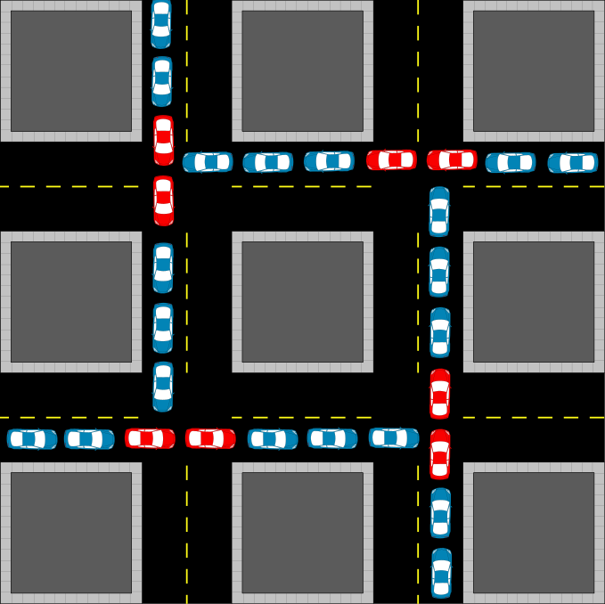

---

# Deadlock: de ce e greu de studiat?

- mulți utilizatori: sistem greu de depanat
- puțini utilizatori: ușor de depanat, dar greu de reprodus

<!--
Este destul de complicat de depanat sistemul când avem mulți utilizatori, dar în cazul în care ai un număr mic de utilizatori, e ușor de depanat, însă mai greu de reprodus.
-->

---

<!-- _class: img -->
<small>Simulare generată de Claude: pool de conexiuni, micșorat de la 10 la 1 · <a href="connection_pool_deadlock.html" target="_blank">deschide direct</a></small>

<iframe src="connection_pool_deadlock.html" style="width:1180px;height:580px;border:0;border-radius:8px;background:#fff"></iframe>

---

# Deadlock N=1 vs. AI

- la N=1 fenomenul **converge singur spre starea dorită**: problema se reproduce și e ușor de studiat
- alt exemplu: OOM
  - uneori sistemul afișează mesajul `OutOfMemory`
  - soluție: micșorăm memoria totală și eroarea se reproduce mult mai repede
  - astfel se vede mai clar cauza: cine cere multă memorie sau cine ocupă prea multă memorie

<!--
La N=1 fenomenul însuși converge către starea dorită, se reproduce problema și e ușor de studiat.

Alt exemplu OOM: uneori un sistem afișează mesajul OutOfMemory. Soluție: dacă micșorăm memoria totală, vom reproduce eroarea mult mai repede și se va vedea mai clar cauza: cine cere multă memorie sau cine ocupă prea multă memorie.
-->

---

# Deadlock: cazul particular în locul celui general (specializare)

- nu am delegat problema către AI
- în loc de problema generală, am luat un caz particular, mai simplu (N=1, memorie mică)
- cazul particular **converge singur spre starea dorită**, deci s-a dovedit mai ușor de reprodus și de studiat
- prin el am găsit soluția și pentru problema generală

<!--
Nu am delegat problema către AI. În loc de problema generală am luat un caz particular, care s-a dovedit mai simplu, și prin care am găsit soluția și pentru problema generală.
-->

---

# Exemplu: problema N+1 (N+1 query)

- din experiența mea, la o problemă de performanță primul lucru de verificat: avem problema N+1?

<!--
Foarte des, când avem o problemă de performanță, primul lucru pe care ar trebui să-l verificăm este dacă avem problema N+1.
-->

---

<!-- _class: img -->
<small>Sursa desenului: https://dev.to/dilip_v_p/the-n1-query-problem-how-one-page-fires-2101-queries-and-how-to-get-back-to-3-3l3i</small>

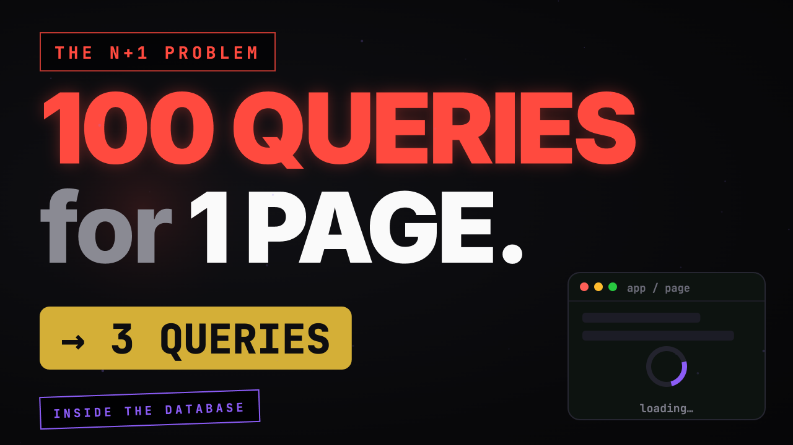

---

<!-- _class: img -->

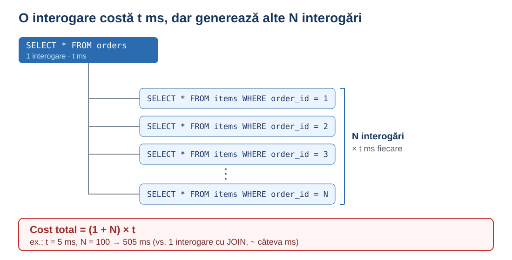

---

# N+1: o problemă mai simplă în locul celei inițiale (problemă auxiliară)

- există biblioteci care detectează această problemă, dar presupunem că nu le folosim
- avem acces la jurnalul de SQL-uri
  - foarte multe interogări, cu atât mai multe cu cât avem mai mulți utilizatori

<!--
Sunt biblioteci care au această funcție activată, dar să presupunem că nu folosim asemenea biblioteci. Să presupunem că avem acces la jurnalul de SQL-uri.
Sunt foarte multe interogări, mai ales dacă ai mulți utilizatori.
-->

---

<!-- _class: log -->

# Cum arată în jurnalul de SQL

<pre><span>10:15:01.101  SELECT id, user_id FROM orders WHERE user_id = ?</span>
<span>10:15:01.104  SELECT * FROM order_items WHERE order_id = ?</span>
<span>10:15:01.106  SELECT name, price FROM products WHERE id = ?</span>
<span>10:15:01.107  SELECT name, price FROM products WHERE id = ?</span>
<span>10:15:01.109  SELECT * FROM order_items WHERE order_id = ?</span>
<span>10:15:01.110  SELECT name, price FROM products WHERE id = ?</span>
<span>10:15:01.112  SELECT label FROM categories WHERE id = ?</span>
<span>10:15:01.113  SELECT * FROM order_items WHERE order_id = ?</span>
<span>10:15:01.115  SELECT name, price FROM products WHERE id = ?</span>
<span>10:15:01.116  SELECT label FROM categories WHERE id = ?</span>
<span>10:15:01.118  SELECT * FROM order_items WHERE order_id = ?</span>
<span>10:15:01.119  SELECT name, price FROM products WHERE id = ?</span>
<span>10:15:01.121  SELECT * FROM order_items WHERE order_id = ?</span>
<span>10:15:01.122  SELECT name, price FROM products WHERE id = ?</span>
<span>10:15:01.124  SELECT label FROM categories WHERE id = ?</span>
<span>10:15:01.125  SELECT * FROM order_items WHERE order_id = ?</span>
<span>10:15:01.127  SELECT COUNT(*) FROM notifications WHERE user_id = ?</span></pre>

<small>Date ilustrative. Același text = aceeași interogare (parametrul <code>?</code>, valorile nu apar în log).</small>

<!--
Jurnalul pare complicat, sunt multe interogări diferite.
-->

---

# N+1: o problemă mai simplă în locul celei inițiale (problemă auxiliară)

- clase de echivalență după numărul de repetări ale interogării: `[1]` excludem, `[2]`, `[3]`... ne interesează
  - ordonăm clasele după numărul de repetări, iar când acesta crește, **răspunsul la întrebare iese singur în evidență** (avem problema N+1?)
- am construit o altă problemă, care se rezolvă simplu și se studiază ușor
  - putem delega către AI să extragă clasele, sau să scrie un fragment de cod care le extrage

<!--
Dar dacă definim clase de echivalență în funcție de numărul de repetări ale unei interogări: [1] excludem, [2], [3] ... ne interesează. Dacă ordonăm clasele după numărul de repetări și acesta crește, răspunsul la întrebare iese singur în evidență: avem problema N+1?

Am construit o altă problemă, care se rezolvă simplu și pe care o putem studia ușor.
-->

---

<!-- _class: log -->

# Cum arată în jurnalul de SQL

<pre><span>10:15:01.101  SELECT id, user_id FROM orders WHERE user_id = ?</span>
<span class="a">10:15:01.104  SELECT * FROM order_items WHERE order_id = ?</span>
<span class="b">10:15:01.106  SELECT name, price FROM products WHERE id = ?</span>
<span class="b">10:15:01.107  SELECT name, price FROM products WHERE id = ?</span>
<span class="a">10:15:01.109  SELECT * FROM order_items WHERE order_id = ?</span>
<span class="b">10:15:01.110  SELECT name, price FROM products WHERE id = ?</span>
<span class="c">10:15:01.112  SELECT label FROM categories WHERE id = ?</span>
<span class="a">10:15:01.113  SELECT * FROM order_items WHERE order_id = ?</span>
<span class="b">10:15:01.115  SELECT name, price FROM products WHERE id = ?</span>
<span class="c">10:15:01.116  SELECT label FROM categories WHERE id = ?</span>
<span class="a">10:15:01.118  SELECT * FROM order_items WHERE order_id = ?</span>
<span class="b">10:15:01.119  SELECT name, price FROM products WHERE id = ?</span>
<span class="a">10:15:01.121  SELECT * FROM order_items WHERE order_id = ?</span>
<span class="b">10:15:01.122  SELECT name, price FROM products WHERE id = ?</span>
<span class="c">10:15:01.124  SELECT label FROM categories WHERE id = ?</span>
<span class="a">10:15:01.125  SELECT * FROM order_items WHERE order_id = ?</span>
<span>10:15:01.127  SELECT COUNT(*) FROM notifications WHERE user_id = ?</span></pre>

<small>Date ilustrative. Același text = aceeași interogare (parametrul <code>?</code>, valorile nu apar în log). Culoare = aceeași interogare repetată.</small>

<!--
Dacă ne uităm atent, unele rânduri se repetă identic. Le-am evidențiat cu culori: aceeași culoare înseamnă aceeași interogare, repetată de multe ori. Doar primul și ultimul rând apar o singură dată.
-->

---

# N+1: abstractizare și problemă auxiliară, nu delegare

- nu am delegat problema către AI
- am folosit abstractizarea: rândurile identice formează o clasă
- clase de echivalență după numărul de repetări ale interogării
- problema auxiliară: în loc să citim tot jurnalul, numărăm repetările pe clase
  - **răspunsul iese singur în evidență**: clasele cu multe repetări indică problema N+1

<!--
Aici n-am delegat către AI. Am folosit abstractizarea: rândurile identice din jurnal le grupez în clase, după numărul de repetări.
Asta e problema auxiliară: în loc să citesc tot jurnalul, lucrez cu clasele și cu numărul de repetări, o problemă mai simplă, care se rezolvă ușor și în care răspunsul iese singur în evidență: clasele cu multe repetări indică problema N+1.
-->

---

# Ce diferență fac proprietățile fenomenului

- 2 exemple (deadlock, N+1): am folosit proprietățile fenomenului, nu am lăsat totul pe AI
  - am rezolvat fără AI: la deadlock fenomenul a **convergit spre starea dorită**, la N+1 **răspunsul a ieșit singur în evidență**
- dacă lăsam totul pe AI, rezultatul ar fi fost același: problema rezolvată
- diferența: persoana a învățat ceva nou și a câștigat experiență
- ce a învățat se aplică și la fenomenele viitoare (problemele, situațiile)

<!--
Ce diferență e între aceste 2 exemple, în care am folosit proprietăți ale fenomenului studiat, și situația în care aș fi pus totul în seama AI?
Rezultatul ar fi același: problema rezolvată. Dar în cazul nostru ai și o persoană care a învățat ceva nou și a câștigat experiență, iar ce a învățat rămâne pentru fenomenele viitoare.
-->

---

# De la A la B: de la euristici la AI

- euristicile nu sunt exhaustive, iar unele probleme nu se rezolvă prin ele: ce rămâne, delegăm
- dar euristicile ne ajută și aici: micșorează ce delegăm
- specializarea dă un caz care se reproduce, problema auxiliară dă o sarcină îngustă, bine definită
- AI primește ceva mic și verificabil (un fragment de cod), nu problema întreagă
- exemplu, cererea fără răspuns: problema auxiliară (clase de echivalență) + AI scrie codul

<!--
Cele două metode nu sunt exhaustive, sunt doar două exemple. Cum ajungem la AI? Ce nu putem rezolva noi, sau ce nu merită efortul, delegăm.
Dar și aici euristicile ajută: nu dau AI-ului problema întreagă. Specializarea îmi dă un caz care se reproduce. Problema auxiliară îmi dă o sarcină îngustă, bine definită, de exemplu „extrage clasele” sau „scrie un fragment de cod”. Ce deleg e mic și îl pot verifica.
Exemplul următor combină cele două lumi.
-->

---

# Exemplu: cerere din browser fără răspuns

- în anumite condiții cererea din browser rămâne fără răspuns, apare aleator
- timeout-uri: presupunem că nu le avem și nu le putem seta
- avem log-ul aplicației în CSV, dar nu știm când s-a reprodus eroarea

<!--
Problema în care în anumite condiții cererea din browser rămâne fără răspuns. Apare aleator.
Prima soluție: punem timeout-uri la cereri. Presupunem că nu le avem și nu le putem seta.
Avem log-ul aplicației în CSV pentru o anumită perioadă de timp, dar nu știm când a fost reprodusă eroarea.
Fragment de CSV.
-->

---

# Cerere fără răspuns: fragment de log (CSV)

```csv
thread,timestamp,message
http-nio-8080-exec-3,10:15:01.112,GET /orders start
http-nio-8080-exec-7,10:15:01.140,GET /report start
http-nio-8080-exec-3,10:15:01.230,GET /orders done
http-nio-8080-exec-5,10:15:02.004,GET /orders start
http-nio-8080-exec-5,10:15:02.118,GET /orders done
...
http-nio-8080-exec-3,10:16:27.377,GET /orders start
http-nio-8080-exec-3,10:16:27.490,GET /orders done
...
http-nio-8080-exec-5,10:19:41.021,GET /orders start
http-nio-8080-exec-5,10:19:41.133,GET /orders done
```

<small>Date ilustrative. Prefixul `http-nio-8080-exec-N` = firul de execuție al serverului web (Apache Tomcat).</small>

<!--
Fragment de CSV: id-ul firului (thread), timestamp, mesaj. Firul exec-7 a început o cerere și n-a mai terminat-o, nici după câteva minute. Cu „..." marchez rândurile omise.
-->

---

<!-- _class: img -->

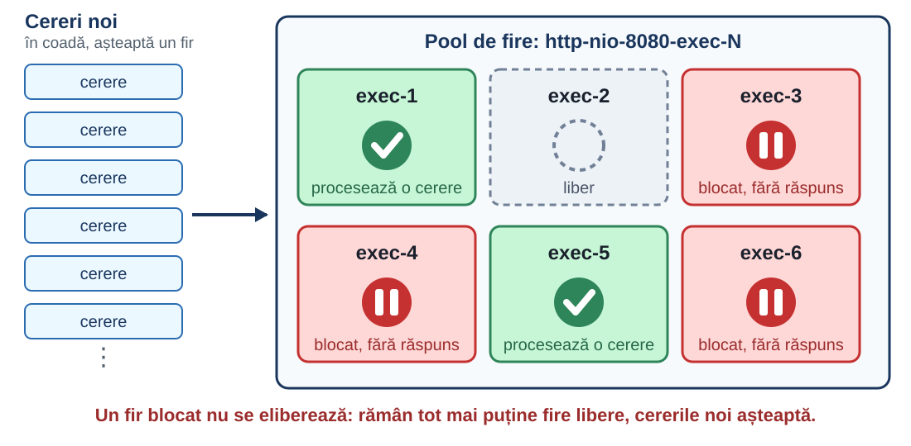

---

# Cerere fără răspuns: aceeași metodă, clase de echivalență

- clase de echivalență după repetarea `http-nio-8080-exec-N`
- firele care n-au răspuns sunt blocate și nu pot fi reutilizate: repetările lor sunt mai puține
- datele sunt în format CSV, iar pentru el există un instrument potrivit: [pandas](https://pandas.pydata.org/) (bibliotecă Python pentru analiza datelor tabelare)
- îi cer AI-ului codul pandas, nu analiza în sine
- adaptez codul (dacă e cazul) și obțin un instrument determinist

<!--
Se poate aplica metoda de mai sus. Clase de echivalență: repetarea http-nio-8080-exec-N, teoretic, cele care n-au răspuns sunt blocate și nu pot fi reutilizate, deci repetările trebuie să fie mai mici.

Eu când văd CSV mă gândesc la pandas: „Am o listă de înregistrări într-un CSV, cu coloane thread (firul de execuție), timestamp și message (mesajul). Dă-mi un cod pandas care afișează fiecare thread cu ultimul timestamp văzut într-un anumit interval de timp.”
Acest fragment îl pot apoi adapta și obțin un instrument determinist.
-->

---

# Cerere fără răspuns: promptul pentru codul pandas

> Am o listă de înregistrări într-un CSV, cu coloane thread (firul de execuție), timestamp și message (mesajul). Dă-mi un cod pandas care afișează fiecare thread cu ultimul timestamp văzut într-un anumit interval de timp.

---

# Cerere fără răspuns: codul pandas

```python
import pandas as pd

df = pd.read_csv("log.csv", parse_dates=["timestamp"])

start, end = "10:15:00", "10:20:00"
interval = df[(df["timestamp"] >= start) & (df["timestamp"] <= end)]

last_seen = interval.groupby("thread")["timestamp"].max()
print(last_seen.sort_values())
```

<small>Firele cu ultimul timestamp cel mai vechi, primele în listă, sunt candidații pentru „blocate”.</small>

---

# Cerere fără răspuns: ce afișează codul

```text
thread
http-nio-8080-exec-7   2026-11-13 10:15:01.140
http-nio-8080-exec-3   2026-11-13 10:16:27.490
http-nio-8080-exec-5   2026-11-13 10:19:41.133
Name: timestamp, dtype: datetime64[us]
```

<small>Firul <code>exec-7</code> e primul: ultima activitate a lui e la 10:15:01, cu aproape 5 minute înaintea celorlalte. El e firul blocat.</small>

<!--
Codul afișează fiecare fir cu ultimul timestamp văzut, sortat crescător. Pe fragmentul nostru, exec-7 apare primul: a început GET /report la 10:15:01 și de atunci nu l-am mai văzut, în timp ce celelalte fire au activitate până la 10:19. Acela e firul blocat.
-->

---

<style scoped>
pre code { font-size: 20px; line-height: 1.35; }
</style>

# Cerere fără răspuns: a doua soluție, desenăm o figură

```python
import pandas as pd
import matplotlib.pyplot as plt

df = pd.read_csv("log.csv", parse_dates=["timestamp"])
df["op"] = df["message"].str.split().str[-1]  # start / done
df["req"] = df.groupby(["thread", "op"]).cumcount()

w = df.pivot(index=["thread", "req"], columns="op", values="timestamp").reset_index()
begin = (w["start"] - df["timestamp"].min()).dt.total_seconds()
length = (w["done"].fillna(df["timestamp"].max()) - w["start"]).dt.total_seconds()

plt.barh(w["thread"], length, left=begin, edgecolor="C0", linewidth=2)
plt.xlabel("secunde de la începutul log-ului")
plt.show()
```

<!--
A doua soluție, tot cu pandas, dar fără grupare: desenez o figură (euristica „desenează o figură”). Pentru fiecare cerere desenez o bară de la start la done. Cererea care n-a primit niciodată done se desenează până la sfârșitul log-ului.
-->

---

<!-- _class: img -->

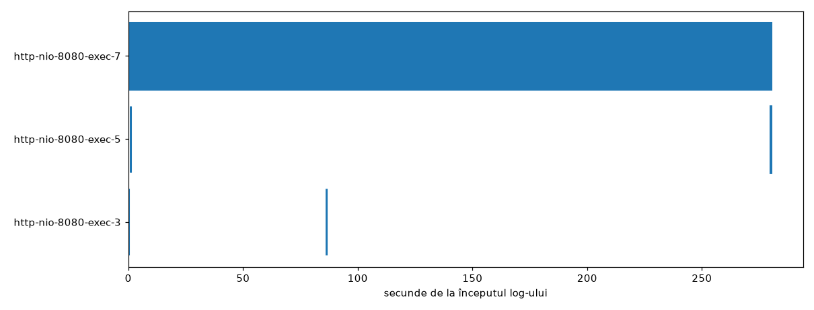

<small>Fiecare bară = o cerere, de la start la done. Cererile terminate sunt linii scurte; doar <code>exec-7</code> are o bară care nu se mai termină.</small>

<!--
Dintr-o privire se vede firul blocat: toate cererile sunt scurte, doar exec-7 începe la 10:15:01 și nu se mai termină. Nu mai e nevoie de cod de grupare.
-->

---

# B. Exemplu: skillul /wayfinder pentru situații necunoscute

- problemă nouă: nu știu de unde să încep (formulare neclară sau primii pași costisitori)
- Wayfinder pune întrebări, construiește lanțul de pași, ține evidența
- AI execută pașii tehnici (librării, programe) în câteva minute
- eu rulez programele și analizez rezultatele
- generalizare: **gradul de finețe în interacțiunea cu AI**
  - înlocuiesc prezentarea tuturor opțiunilor cu prezentarea opțiune cu opțiune

<small>Sursa: https://github.com/mattpocock/skills/tree/main/skills/engineering/wayfinder</small>

<!--
A doua abordare: delegăm către AI. Prima situație: când suntem la început și fie avem o formulare pe care, chiar dacă o citim de 10 ori, nu știm de unde s-o începem și încotro să ne ducem, fie pașii inițiali necesită mult efort.

Într-o astfel de situație am o experiență foarte bună cu un instrument public, Wayfinder, de Matt Pocock. Instrumentul pune întrebări, pe baza răspunsurilor definește un lanț de pași și memorează ce pași ai executat și care au mai rămas. Îl utilizez și când citesc un articol tehnic cu fragmente de cod de executat, sau care discută algoritmi: cu Wayfinder îmi definesc pașii care îmi trebuie; pașii care presupun instalare de librării și scriere de programe sunt executați de AI în câteva minute, iar eu pot rula programele, vedea rezultatele și analiza. Astfel pot analiza și scoate concluziile dintr-un articol complicat foarte repede.

Metoda se poate generaliza în „gradul de finețe în interacțiunea cu AI”; ambele cuvinte sunt importante: „finețe” (cât de fină vs grosieră) și „interacțiune”.
-->

---

<!-- _class: img -->

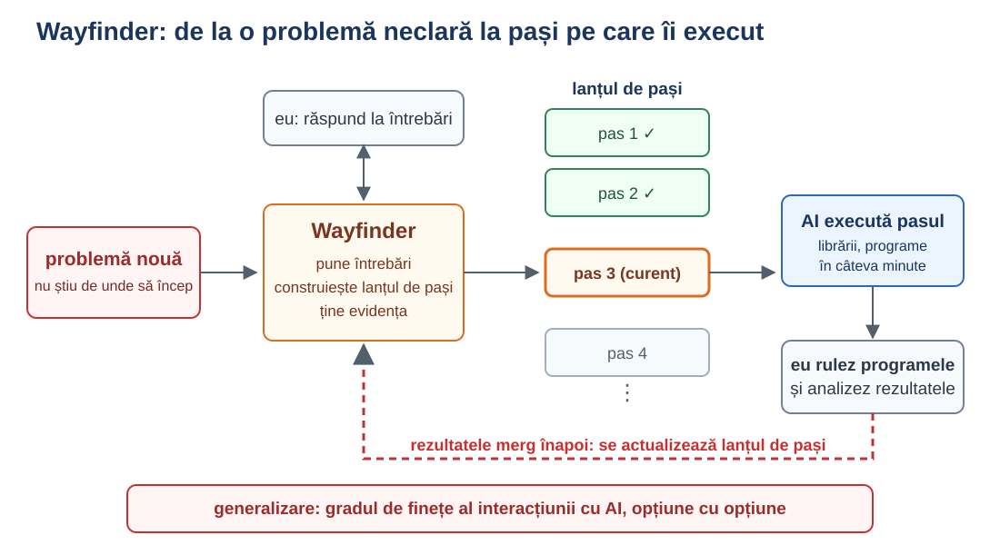

---

# Situații necunoscute: AI e foarte bună la enumerare

Problema nouă, pasul următor: ce opțiuni am?

- întrebări la care nu m-am gândit
- riscuri și cazuri limită
- alternative și variante
- ipoteze ascunse
- criterii de comparare
- ce aș putea să fi uitat
- exemple și contraexemple

AI enumeră și ce nici nu știam că există, iar astfel **ne orientăm spre direcția corectă** de rezolvare a problemei.

<!--
AI e foarte bună la enumerare: întrebări la care nu m-am gândit, riscuri, variante, ipoteze ascunse, criterii de comparare. Umple lista cu elemente apropiate semantic și îmi arată zone la care nu m-aș fi gândit singur. Enumerând și ce nici nu știam că există, AI ne ajută să ne orientăm spre direcția corectă de rezolvare a problemei. Eu aleg ce are sens și verific.
-->

---

# Exemplu: schimbăm modul de prezentare, cerem și explicația vizuală de la AI

Problema nouă, pasul următor: înțeleg rezultatul repede.

- articol: [„How to 5x your communication effectiveness with Claude Code”](https://towardsdatascience.com/how-to-5x-your-communication-effectiveness-with-claude-code/) (Towards Data Science)
- agentul scrie rezultatele netriviale ca fișier HTML, deschis în browser, nu ca text în terminal
- instrucțiunea se pune o dată, în fișierul MD la nivel de utilizator
- skill-uri pentru sarcini concrete (ex. raport de teste)
- concluziile apar la final, rezultatul e prezentat vizual

<!--
Exemplul precedent arăta că deseori e binevenit să începem abordarea complexității cu AI. Aici vorbesc despre etapele intermediare, sau chiar etapa finală, și mai ales despre prezentarea rezultatelor.

Am întâlnit un articol foarte interesant exact în momentul când obosisem să citesc răspunsurile de la AI. Metoda din articol (agentul scrie rezultatul netrivial ca fișier HTML, deschis în browser, în loc de text în terminal) accelerează înțelegerea: pune concluziile la final și prezintă rezultatul vizual. Instrucțiunea merge o singură dată într-un fișier MD la nivel de utilizator; pentru sarcini concrete (ex. raport de teste) se folosesc skill-uri.

Generalizare: „Cere și explicația vizuală de la AI”.

Sursa: https://towardsdatascience.com/how-to-5x-your-communication-effectiveness-with-claude-code/
-->

---

# Explicația vizuală: ce iese în evidență

- explicația vizuală ne ajută să **înțelegem rezultatul mai repede**
- ce contează **iese singur în evidență**, în loc să fie ascuns în text lung
- astfel ne orientăm mai repede spre direcția corectă

<!--
Aceeași idee ca la enumerare, dar la nivelul prezentării: când rezultatul e vizual, ce contează iese în evidență și ne ajută să ne orientăm mai repede spre direcția corectă.
-->

---

# Exemplu: analiza unei probleme de performanță – git worktree

- problemă de performanță
- opțiuni: modific ce există sau fac upgrade la o versiune nouă a librăriilor
- ce aleg? cum măsor?
- git worktree: experimentăm, salvăm rezultatele, comparăm

<!--
Am o problemă de performanță. Presupun că pot s-o rezolv modificând ceva existent sau făcând upgrade la o nouă versiune a librăriilor.
Ce să aleg? Cum să măsor?
Cu git worktree experimentăm, salvăm rezultatele și comparăm.
-->

---

<!-- _class: img -->

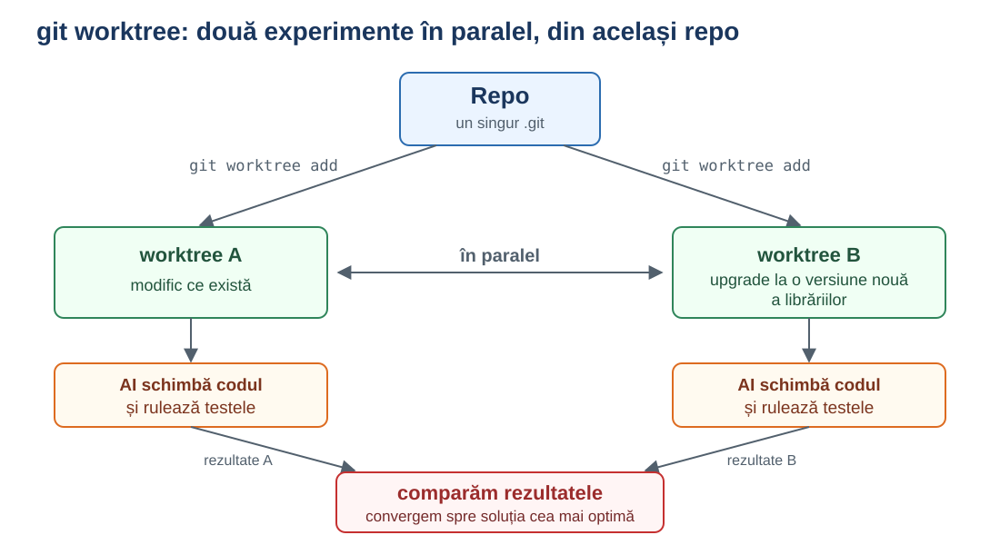

---

# Exemplu: modificarea consumului de memorie după upgrade

- după upgrade, aplicația consumă mai multă memorie
- **AI generează un benchmark** care, pentru un endpoint de API, măsoară și salvează numărul de bytes alocați
- **git worktree**: același benchmark rulează pe ramura curentă și pe un commit dinainte de upgrade
- numerele diferă, deci avem o referință măsurabilă
- **AI primește numerele** și caută cauza
  - a găsit exact biblioteca care, după upgrade, a început să consume mai multă memorie

<!--
După upgrade am văzut că se consumă mai multă memorie.
Am generat cu AI un benchmark care, pentru un endpoint de API, măsoară și salvează numărul de bytes alocați.
Cu git worktree am rulat benchmark-ul pe ramura curentă și pe un commit de dinainte de upgrade, și am comparat numerele. S-a adeverit că diferă.
Având numerele ca o referință, am rugat AI să găsească problema, și mi-a găsit exact biblioteca care, după upgrade, a început să se comporte așa.
Observație: AI a construit instrumentul de măsură, dar măsurătoarea e deterministă și o controlez eu; apoi AI lucrează pe numere, nu pe presupuneri.
-->

---

<!-- _class: img -->

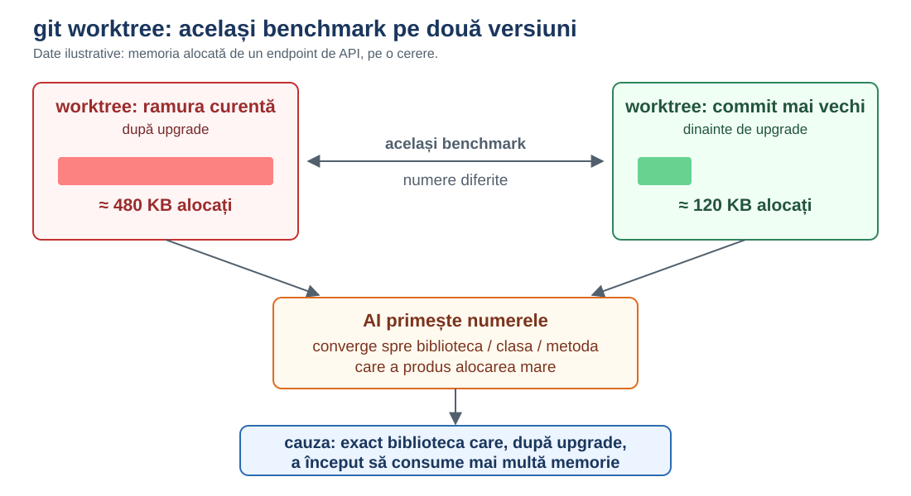

---

# Exemplu: API care întoarce un arbore prea mare

- API-ul întoarce o structură arborescentă, prea mare: programul pică
- soluția propusă de AI (răspuns mediu): introduceți paginarea
- se poate, dar răspunsul nu mă aranjează și nu mă grăbesc să-l aplic
  * paginarea pe arbore e mai complexă decât pe o structură liniară

<!--
Într-un sistem un API întoarce o structură arborescentă. Structura e prea mare, și programul pică.
AI-ul spune (răspuns mediu) că trebuie să introducem paginarea. Se poate, dar răspunsul nu mă aranjează și nu mă grăbesc să-l aplic: paginarea pe o structură arborescentă e o modificare mai complexă decât pe o structură liniară.
-->

---

<!-- _class: img -->
<small>Sursa desenului: https://commons.wikimedia.org/wiki/File:Tree-data-structure.svg</small>

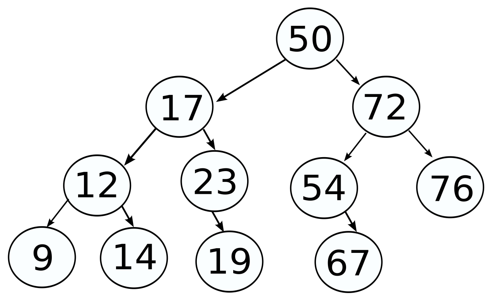

---

# Arbore prea mare: delegăm AI generarea soluțiilor posibile și verificarea

- **construiesc teste** care folosesc API-ul și pică
- **AI marchează toate locurile** unde e folosit API-ul, făcându-l să returneze eroare
- **studiez fiecare loc** în parte
   - uneori există deja un API de căutare
   - alteori sunt de ajuns copiii de primul nivel, nu tot arborele
- **AI încearcă fiecare soluție**: schimbă codul și rulează testele
   - eu verific dacă testele pică în aceleași condiții

<!--
1. am construit câteva teste care foloseau acel API și picau.
2. am rugat AI să comenteze/returneze eroare de la acest API în toate locurile unde e folosit.
3. m-am gândit la câteva soluții și am rugat AI să genereze fiecare soluție, adică să schimbe codul și apoi să ruleze testele, iar eu analizez dacă pică sau nu și dacă pică în aceleași condiții sau nu.
4. am studiat fiecare loc în parte și am descoperit că în unele locuri acest API ar fi putut fi înlocuit cu un API de căutare care există deja, iar în alte locuri era nevoie doar de descendenții de primul nivel, adică de copii, nu de întreaga structură arborescentă.
-->

---

# Arbore prea mare: enumerarea variantelor, AI umple lista

Structura arborescentă e prea mare. Variante:

- paginare
- limitarea adâncimii (doar copiii de primul nivel)
- încărcare leneșă (lazy loading) a subarborilor
- structură plată (listă de noduri cu `parentId`)
- selectarea câmpurilor (doar ce e necesar)
- API de căutare / filtrare în loc de întregul arbore
- streaming în loc de un singur răspuns

<!--
Exemplul cu arborele evidențiază un aspect la care AI e foarte bună: enumerarea variantelor. Îi cer să facă exemple, iar AI umple lista cu elemente apropiate semantic: de la o singură idee (paginarea) obțin o familie întreagă de soluții înrudite. Eu aleg apoi ce are sens, de preferință pe rând: câte o variantă, o înțeleg, apoi cer următoarea.
-->

---

# Exemplu: dashboard-uri Grafana generate de AI

- **nevoia**: monitorizăm ceva în Grafana, cu câteva dashboard-uri noi
- **formatul**: dashboard-urile Grafana sunt fișiere JSON
- **AI generează** JSON-ul, iar eu îl import în Grafana
- **rezultatul**: sunt scutit de munca manuală de a crea dashboard-urile

<!--
Am de monitorizat ceva în Grafana, trebuie să fac câteva dashboard-uri noi. E timp.
Știu că dashboard-urile sunt în JSON, îi cer AI să-mi genereze dashboard-urile JSON, iar eu le import.
-->

---

<!-- _class: img -->
<small>Sursa desenului: https://commons.wikimedia.org/wiki/File:Grafana_screenshot_(2018).png</small>

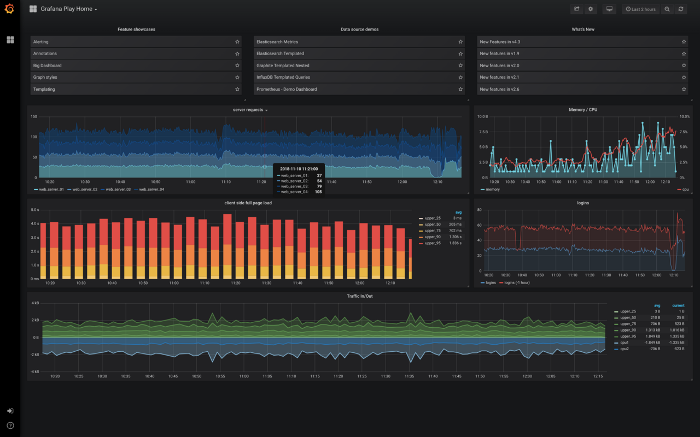

---

# Ce se poate reprezenta digital, AI produce rapid

- în mediul digital, tot ce se poate reprezenta pur digital (un widget JSON, un dashboard, un fișier de configurare) AI produce în câteva secunde
- același rezultat, manual, înseamnă o secvență de pași: interfață, click-uri, configurări, verificări
- rezultatul e un artefact pe care îl import și îl verific eu

<!--
Dashboard-ul Grafana e doar un JSON. Pentru AI, un JSON e doar text pe care îl generează în câteva secunde. Același lucru, făcut manual în interfață, înseamnă zeci de pași.
-->

---

# Exemplu: autentificare automată în teste

- **problema**: testele necesită autentificare
- **script Playwright de login**, construit de AI, obține un bearer token
- **credențialele** sunt într-un fișier `.env`, iar tokenul se salvează în `auth.json`
- testele citesc automat `auth.json`
- dacă tokenul a expirat, se pornește singur scriptul Playwright și obține unul nou
- **rezultatul**: totul merge determinist, fără intervenția mea

<!--
În situațiile în care e nevoie de autentificare, de exemplu în teste, am un script Playwright construit de AI. Credențialele sunt într-un fișier .env, iar bearer token-ul se salvează într-un auth.json, pe care testele îl citesc automat. Dacă tokenul e vechi, se pornește scriptul Playwright. Nu mai e nevoie de implicarea mea, totul merge determinist.
-->

---

<!-- _class: img -->

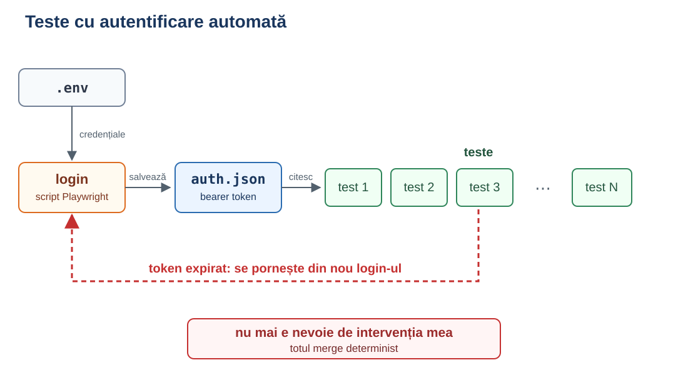

---

# Exemplu: delegăm AI telemetria

- rulăm testele (sau chiar procesul) și colectăm:
  - **log-urile** aplicației
  - **metrici Prometheus**
  - **flamegraph** (unde își petrece programul timpul)
- delegăm toate acestea către AI
- o singură întrebare: **„Vezi ceva anormal în aceste date?”**
- AI ne ajută să **convergem foarte repede** spre cauza problemei

<!--
După ce testele rulează automat, colectez ce produce procesul: log-uri, metrici Prometheus și un flamegraph. Flamegraph-ul e o vizualizare a profilării: fiecare bară e o funcție, lățimea ei arată cât din timp (sau din eșantioanele CPU) a petrecut programul în ea, iar înălțimea arată adâncimea apelurilor. Axa orizontală nu e timpul, e doar grupare; ce contează e lățimea.
Le dau AI-ului pe toate și pun o singură întrebare, fără să-i spun ce să caute: „Vezi ceva anormal în aceste date?” AI ne ajută să convergem foarte repede spre cauza problemei.
-->

---

# De ce nu delegăm totul către AI?

- problemele simple, de rutină, le delegăm deja
- AI se descurcă bine și cu cele complexe
- deci de ce nu delegăm întreaga complexitate?
  - dăm problema, luăm răspunsul
- **răspunsul din exemplele de mai sus**: abordarea mea e să stabilesc corect ce parte delegăm AI și ce parte nu

<!--
Mulți ar putea obiecta și spune că putem delega întreaga complexitate către AI, fără skill-uri sau formate de prezentare. Dacă AI rezolvă bine problemele simple, de ce să nu delegăm și cele complexe?
Din toate exemplele prezentate se poate trage concluzia că abordarea mea este să stabilesc corect ce parte delegăm AI și ce parte nu.
-->

---

# Ce pierdem dacă delegăm totul: modelul mental

- înțelegerea unui fenomen cere un model mental al acestuia
- sarcini simple: modelul mental există deja
  - nu pierdem nimic delegând către AI
- sarcini complexe: modelul mental încă nu există
  - delegându-le către AI, pierdem șansa să ne formăm modelul
- formarea modelului mental necesită timp
- noi decidem: ne trebuie modelul sau nu? (raportul timp:rezultat cu AI e foarte bun)

<!--
Concluzia mea e simplă: pentru a înțelege un fenomen îți trebuie un model mental al acestui fenomen.
Delegând sarcinile simple către AI, pentru care avem deja modele mentale formate, nu pierdem nimic.
Delegând însă sarcinile complexe către AI pierdem șansa să ne formăm modelul mental.
Însă formarea modelului mental necesită timp.
Noi trebuie să decidem dacă ne trebuie acest model mental sau nu, pentru că raportul timp:rezultat atunci când folosești AI e foarte bun.
-->

---

# De ce îți trebuie modelul mental?

- **abordare reutilizabilă**: un fenomen complex înțeles bine ne ajută să abordăm mai ușor alte fenomene din aceeași familie
- **calitatea rezultatului**: raportul timp:rezultat nu e suficient
  - rezultatul poate fi **neoptim** (multe iterații): trebuie să schimbăm felul în care AI abordează problema
  - rezultatul poate fi **incorect**, pentru că AI e non-deterministă: avem nevoie de subrezultate deterministe
- ambele cer mai mult decât un model superficial al fenomenului

<!--
Fenomenul complex trebuie abordat astfel încât să poți aborda ușor orice alte fenomene complexe din aceeași familie.

Însă raportul timp:rezultat nu e întotdeauna suficient. Mai apare și dimensiunea calității rezultatului:
1. rezultatul poate să nu fie optim (sau poate să facă multe iterații), și atunci cel mai des trebuie să schimbi felul în care abordează AI problema, dar pentru asta un model superficial al fenomenului nu e suficient
2. rezultatul poate să nu fie corect din cauza naturii non-deterministe a AI și pentru asta îți trebuie subrezultate deterministe, la care iarăși nu ajungi cu modele superficiale ale fenomenului.
-->

---

> **Interviewer:** “I heard you were extremely quick at math.”
>
> **Me:** “Yes, as a matter of fact I am.”
>
> **Interviewer:** “What is 14 × 27?”
>
> **Me:** “49.”
>
> **Interviewer:** “That’s not even close.”
>
> **Me:** “Yeah, but it was fast.”

<small>Glumă populară pe internet.</small>

<!--
O glumă populară pe internet, fără autor cunoscut, care ilustrează slide-ul precedent: AI poate da soluții neoptime sau greșite. Rapid, dar greșit: viteza nu garantează corectitudinea (14 × 27 = 378).
-->

---

# Experiment: „copiază imaginea” de 101 ori

- postare pe Reddit (r/ChatGPT): aceeași poză cu Dwayne Johnson, recreată de ChatGPT de 101 ori, de fiecare dată pornind de la rezultatul anterior
- cerința: „Create the exact replica of this image, don't change a thing”
- primele variante seamănă cu originalul, apoi trăsăturile se deformează până la artă abstractă

<small><a href="https://www.reddit.com/r/ChatGPT/comments/1kbj71z/i_tried_the_create_the_exact_replica_of_this/" target="_blank">Postarea originală (Reddit, u/Foreign_Builder_2238)</a> · publicații similare: <a href="https://www.techradar.com/computing/artificial-intelligence/viral-chatgpt-trend-gone-wrong-the-rock-is-turned-into-horrible-abstract-art-after-reddit-user-recreates-image-101-times" target="_blank">TechRadar</a>, <a href="https://knowyourmeme.com/memes/replicate-this-image-100-times" target="_blank">Know Your Meme</a>, <a href="https://dailydot.com/chatgpt-100x-ai-image-loop" target="_blank">Daily Dot</a>, <a href="https://www.kapwing.com/resources/how-to-do-the-100x-chatgpt-image-trend/" target="_blank">Kapwing</a></small>

<!--
Videoul nu e în prezentare, drepturile rămân la autorul postării de pe Reddit. Link-ul duce la postare.
Ideea: AI e non-deterministă și dă ceva nou de fiecare dată, chiar și când i se cere explicit să reproducă exact. Erorile mici se acumulează la fiecare pas, deci rezultatul nu e determinist și nu putem presupune că „nu schimbă nimic”.
-->

---

# Al treilea participant: modelul (fenomenul)

- **polarizarea de azi**: de o parte omul, de cealaltă AI
- **al treilea participant**: modelul (fenomenul)
  - poate fi un model mental, un model software, un cadru științific, cunoștințe, ...
- **la îndemână**: le putem folosi direct, fără AI

<!--
Eu mi-am răspuns la această întrebare. Răspunsul e subiectiv, dar este următorul:

În realitatea actuală, am observat o polarizare: într-o parte omul, în cealaltă AI. Eu am să numesc al treilea participant modelul (fenomenul).
Modelul poate fi mental, poate fi model software, poate fi un cadru științific, cunoștințe ... la care avem acces direct, fără AI.
-->

---

<!-- _class: img -->

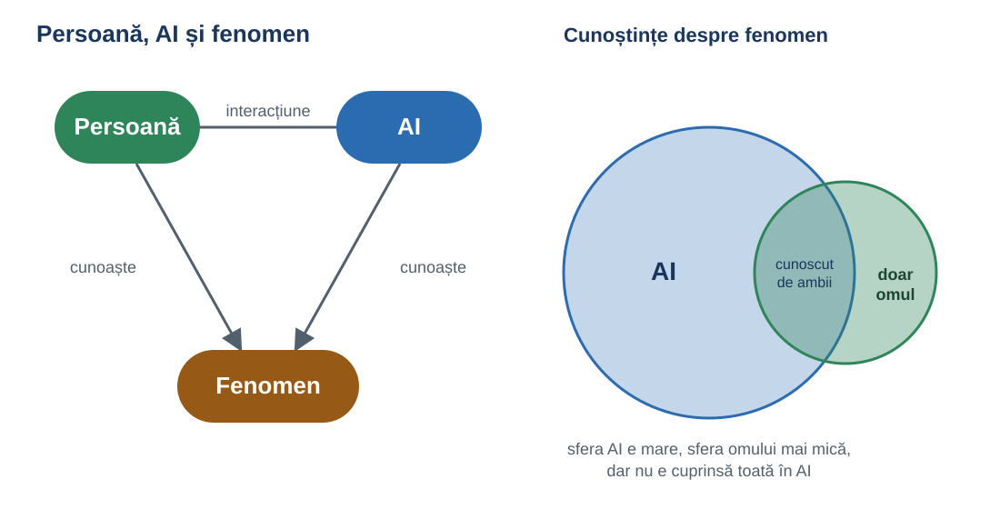

---

# Regula mea

- **primul pas**: poate modelul fenomenului să rezolve problema cu efort minim?
- **dacă pot amândoi** (modelul fenomenului și AI), nu folosim AI
  - proprietățile fenomenului fac ca acesta să **convergă singur spre starea dorită**, iar soluția iese în evidență
- AI poate rezolva multe probleme, dar **nu e singurul participant** care poate: poate și modelul

<!--
Regula mea este următoarea. Mă întreb cine poate rezolva problema cu efort minim: modelul fenomenului sau AI. Dacă pot amândoi, nu folosim AI.

De aceea, întâi trebuie să ne gândim: e posibilă oare o abordare în care modelul fenomenului depune un efort minim?

Noi folosim AI pentru că poate, dar mai există și alți participanți care pot, ca de exemplu modelul.
-->

---

<small>Imaginile din această prezentare fără sursă indicată (inclusiv cea de pe slide-ul de titlu) au fost generate cu ajutorul Claude Code.</small>

---

# În loc de concluzie: cum a măsurat Eratostene Pământul cu un simplu băț

- **Eratostene din Cirene** (cca 276–194 î.Hr.), în jurul anului 240 î.Hr.
- la solstițiul de vară, la amiază, în Syene (azi Assuan, în Egipt) soarele era la zenit: bățul nu avea umbră
- în același moment, în Alexandria, bățul făcea cu razele Soarelui un unghi de ≈ 7,2° (măsurat după umbră), adică 1/50 dintr-un cerc
  - un cerc întreg are 360°, iar 360° : 7,2° = 50
- razele Soarelui sunt **paralele**, deci același unghi apare și la centrul Pământului, între cele două orașe

<!--
Un exemplu clasic de problemă complexă rezolvată cu un model simplu: Eratostene a transformat problema globului într-o problemă de geometrie, cu un unghi și o proporție (euristicile „desenează o figură” și „problemă auxiliară”). Fără calculator și fără AI, doar cu înțelegerea fenomenului: razele Soarelui sunt paralele, iar Pământul e rotund. Unghiul de 7,2° e cel dintre băț și raza de soare; fiindcă razele sunt paralele, același unghi apare la centrul Pământului, între cele două orașe.
-->

---

<!-- _class: img -->

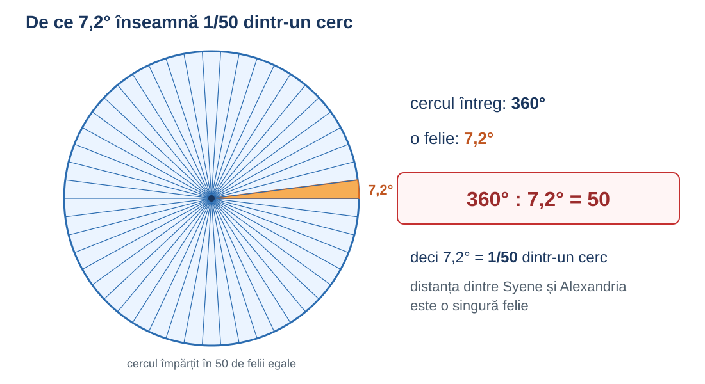

---

# În loc de concluzie: Eratostene, stadii și circumferința

- **stadiu** = unitate de lungime din Grecia antică, după lungimea pistei de alergare dintr-un stadion
  - stadiul egiptean ≈ 157,5 m, cel atic ≈ 185 m: nu se știe sigur care a fost folosit
- distanța dintre orașe: ≈ 5000 de stadii (≈ 800–925 km)
- circumferința Pământului: ≈ 50 × 5000 = **250 000 de stadii** (≈ 39 000–46 000 km; valoarea reală: ≈ 40 075 km)

<!--
Stadiul e o unitate de lungime din antichitate, de la pista de alergare dintr-un stadion. Mărimea exactă a stadiului folosit e disputată, deci cât de aproape de valoarea reală a ieșit rezultatul depinde de ea.
-->

---

<!-- _class: img -->

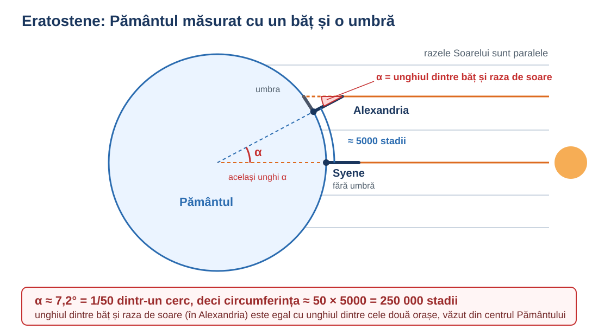

---

# Câți tokeni a cheltuit Eratostene din Cirene?

<!--
Întrebare-glumă, ca să încheiem cu zâmbetul pe buze: Eratostene a măsurat Pământul fără AI, deci fără niciun token.
-->
