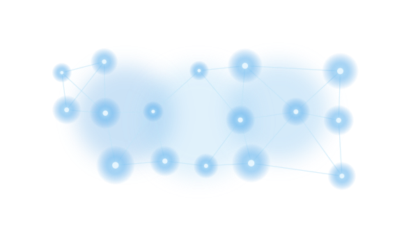
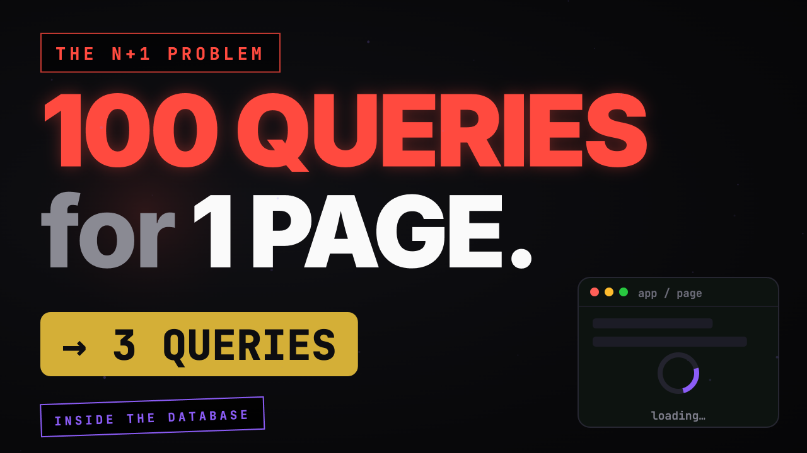
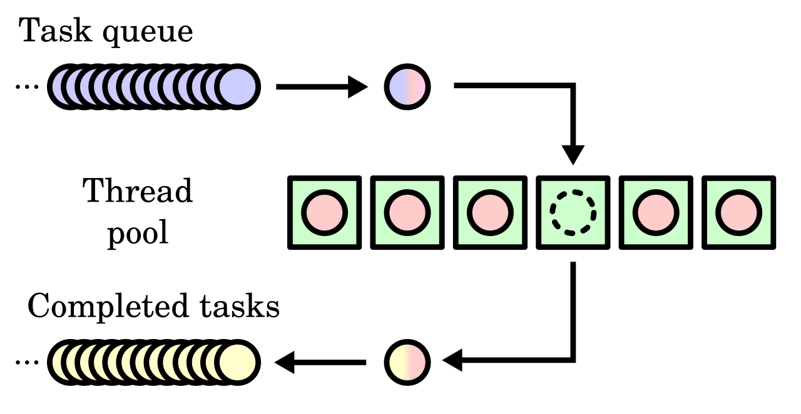
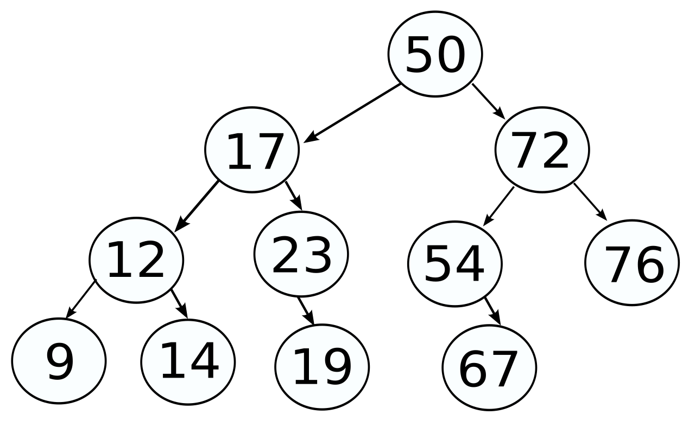
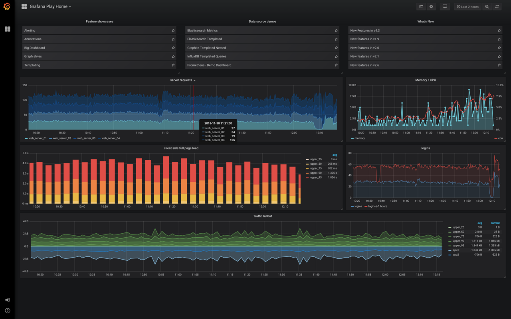

<!-- _class: title -->
<!-- _paginate: false -->

# Navigating Complexity with GenAI

**Radu Dumbrăveanu**
Bălți · BitConf 2026

---

# Prin complexitate mă refer la:

- sisteme / fenomene / probleme cu mulți factori interconectați
- granițe neclare între factori
- combinații greu de prevazut exhaustiv
- și situații care doar par complexe (formulă sau perspectivă)

<!-- 
Prin complexitate mă voi referi la situații, sisteme, fenomene, probleme, care constau din mai mulți factori
(variabile, componente) interconectate astfel încât este greu să tragi o graniță clară între ei și e greu să
prevezi toate combinațiile posibile ale acestora. 
La fel, prin complexitate mă voi referi și la situațiile care
par așa (adică par complexe la prima vedere) fie din cauza formulării, fie din cauza subiectului care abordează
situația.
-->

---

# Wayfinder (Matt Pocock)

- început dificil: formulare neclară sau primii pași costisitori
- Wayfinder pune întrebări, construiește lanțul de pași, ține evidența
- IA execută pașii tehnici (librării, programe) în câteva minute
- eu rulez, văd rezultatele, analizez
- generalizare: **gradul de finețe în interacțiunea cu IA**

<!--
Primul exemplu: situațiile când suntem la început, și fie avem o formulare la care chiar dacă o citim de 10 ori nu știm de unde să începem și încotro să ne ducem, sau pașii inițiali necesită mult efort.

În așa situație am o experiență foarte bună cu un instrument public, Wayfinder, de Matt Pocock. Instrumentul pune întrebări, pe baza răspunsurilor definește un lanț de pași și memorează care pas l-ai executat și care mai ai. Îl utilizez și când citesc un articol tehnic cu fragmente de cod de executat, sau care discută algoritmi: cu Wayfinder îmi definesc pașii care îmi trebuie; pașii care presupun instalare de librării și scriere de programe sunt executați de IA în câteva minute, iar eu pot rula programele, vedea rezultatele și analiza. Astfel pot analiza și scoate concluziile dintr-un articol complicat foarte repede.

Metoda se poate generaliza în „gradul de finețe în interacțiunea cu AI”; ambele cuvinte sunt importante: „finețe” (cât de fină vs grosieră) și „interacțiune”.
-->

<!-- TODO desen: wayfinder nu e clar (unealta ta?), de ales împreună -->

---

# IA e foarte bună la enumerare

- întrebări la care nu m-am gândit
- riscuri și cazuri limită
- alternative și variante
- ipoteze ascunse
- criterii de comparare
- ce aș putea să fi uitat
- exemple și contraexemple

<!--
IA e foarte bună la enumerare: întrebări la care nu m-am gândit, riscuri, variante, ipoteze ascunse, criterii de comparare. Umple lista cu elemente apropiate semantic și îmi arată zone la care nu m-aș fi gândit singur. Eu aleg ce are sens și verific.
-->

---

# Cere și explicația vizuală de la IA

- articol: „How to 5x your communication effectiveness with Claude Code” (Towards Data Science)
- agentul scrie rezultatele netriviale ca fișier HTML, deschis în browser, nu ca text în terminal
- instrucțiunea se pune o dată, în fișierul MD la nivel de utilizator
- skill-uri pentru sarcini concrete (ex. raport de teste)
- Archify pentru diagrame
- concluziile apar la final, rezultatul e prezentat vizual

<!--
Exemplul precedent arăta că deseori e binevenit să începem abordarea complexității cu IA. Aici vorbesc despre etapele intermediare, sau chiar etapa finală, și mai ales despre prezentarea rezultatelor.

Am întâlnit un articol foarte interesant exact în momentul când obosisem să citesc răspunsurile de la IA. Metoda din articol (agentul scrie rezultatul netrivial ca fișier HTML, deschis în browser, în loc de text în terminal) accelerează înțelegerea: pune concluziile la final și prezintă rezultatul vizual. Instrucțiunea merge o singură dată într-un fișier MD la nivel de utilizator; pentru sarcini concrete (ex. raport de teste) se folosesc skill-uri, iar pentru diagrame Archify.

Generalizare: „Cere și explicația vizuală de la IA”.

Sursa: https://towardsdatascience.com/how-to-5x-your-communication-effectiveness-with-claude-code/
-->

---

# Din practica mea: carduri cu noțiunile necunoscute

- studiez ceva nou, apar noțiuni necunoscute
- Claude generează carduri pentru ele
- le pune în cloud, le am la îndemână
- revin la ele când am nevoie

<!--
Din practica mea: când studiez ceva nou, obișnuiesc să generez carduri cu noțiunile necunoscute. Claude le face și le pune în cloud. Încă o formă de prezentare a rezultatelor, în ajutorul înțelegerii.
-->

<!-- TODO: de adăugat un exemplu concret (captură de ecran a unui card) -->

---

# Exemplu 1: deadlock

Este destul de complicat de depanat sistemul când avem mulți utilizatori, dar în cazul când ai un număr mic de utilizatori, e ușor de depanat, dar e mai greu de reprodus.
La N+1 fenomenul însăși converge către starea dorită, se reproduce problema și e ușor de studiat.

Alt exemplu OOM.

---

<!-- _class: img -->
<small>Sursa desenului: https://commons.wikimedia.org/wiki/File:Process_deadlock.svg</small>

---

# Exemplu 2: problema N+1

Foarte des când avem problemă de performanță primul lucru ar trebui să verificăm, sunt probleme N+1.
Sunt biblioteci care au funcția dată activată, dar să presupunem că nu folosim asemenea biblioteci. Să presupunem că avem acces la jurnalul de SQL-uri.
Sunt foarte multe interogări, și mai ales dacă ai mai mulți utilizatori.
Dar dacă definim clase de echivalență, în funcție de numărul de repetări ale unei interogări. [1] - le exclude, [2], [3] ... ne interesează.

Am construit o altă problemă, care se rezolvă simplu. În care putem s-o studiem ușor.

---

<!-- _class: img -->
<small>Sursa desenului: https://dev.to/dilip_v_p/the-n1-query-problem-how-one-page-fires-2101-queries-and-how-to-get-back-to-3-3l3i</small>

---

# Exemplu 3: problema interogărilor care nu se termină

Problema în care în anumite condiții interogarea din browser nu se termină. Apare aleator.
Prima soluție punem timeout-uri la interogări. Presupunem că nu le avem.
Dar avem log-ul aplicației în CSV pentru o anumită perioadă de timp. Dar nu știm timpul (timpii) când eroarea a fost reprodusă.
Fragment de CSV.

---

Se poate aplica metoda de mai sus. Clase de echivalență: repetarea thread-N, teoretic cele care n-au răspuns, sunt blocate și nu pot fi refolosite, deci repetările trebuie să fie mai mici.

Eu când văd CSV mă gândesc la Pandas. "dacă am o listă de înregistrări într-un CSV cu coloane id, timestamp și message. Dă-mi un cod pandas care afișează fiecare id cu ultimul timestamp văzut într-un anumit interval de timp"
Aceste fragmente le pot apoi adapta și: înveți pandas, + obții un instrument determinist.

---

<!-- _class: img -->
<small>Sursa desenului: https://commons.wikimedia.org/wiki/File:Thread_pool.svg</small>

---

Vă dați seama care diferență în aceste 3 exemple în care am folosit proprietăți ale fenomenului studiat și n-am pus în totalitate în seama IA?
Rezultatul ar fi același : problema rezolvată. Dar în primul caz ai și un om care a înțeles ceva mai mult decât înțelesese până la acel fenomen.

Începem să intrăm în tărâmul IA. Avantajele exemplului 3 dar și al următoarelor care vor combina proprietățile fenomenului și IA.
La fel cum învățăm la școală și universitate fundamentele, ca apoi să le putem combina, așa și învățăm / descoperim proprietăți ale fenomenului, capacități ale IA, capacități ale pandas. Ca în viitor pentru alte fenomene să le combinăm și să abordăm orice problemă complexă.

---

# Exemplul 4:

Într-un sistem un API întoarce o structură arborescentă. Structura e prea mare, și pică.
IA artificială spune (răspuns AVG) că trebuie să introducem paginarea. Paginarea pe o structură arborescentă nu e modificare mai complexă dacă ai introduce pe structură liniară.

---

1. am construit câteva teste care folseau acel API și picau.
2. am rugat IA să comenteze/returneze eroare de la acest API în toate locurile unde e folosit.
3. m-am gândit la câteva soluții și am rugat AI să genereze fiecare soluție, adică să schimbe codul apoi să ruleze testele și analizez dacă pică sau nu și pică în aceleași condiții sau nu.
4. am studiat fiecare loc în parte și am descoperit că unele locuri acest API ar fi putut fi înlocuit cu un API de căutare care deja există, iar în alte locuri era nevoie doar de descendenții de primul nivel, adică copiii nu de întreaga structură arborescentă.

---

<!-- _class: img -->
<small>Sursa desenului: https://commons.wikimedia.org/wiki/File:Tree-data-structure.svg</small>

---

În general exemplul 4 mi-a dat o idee interesantă de a investiga ceva cu AI și anume.
În situația unei probleme dacă îmi explică, sau sugerează, sau orice care îmi dă mai multe opțiuni, eu prefer să lucrez dinamic cu IA și anume:
Să-mi dea câte unul, și când l-am înțeles fie zic dă-mi următorul fie pun întrebări. De multe ori după întrebări, opțiunile următoare sunt recalculate.

---

# Enumerarea variantelor: IA umple lista

Structura arborescentă e prea mare. Variante:

- paginare
- limitarea adâncimii (doar copiii de primul nivel)
- încărcare leneșă (lazy loading) a subarborilor
- structură plată (listă de noduri cu `parentId`)
- selectarea câmpurilor (doar ce e necesar)
- API de căutare / filtrare în loc de întregul arbore
- streaming în loc de un singur răspuns

<!--
Exemplul 4 evidențiază un aspect la care IA e foarte bună: enumerarea variantelor. Îi cer să facă exemple și umple lista cu elemente apropiate semantic: de la o singură idee (paginarea) obțin o familie întreagă de soluții înrudite. Eu aleg apoi ce are sens, de preferință pe rând: câte o variantă, o înțeleg, apoi cer următoarea.
-->

---

Despre fenomene care noi le numim complexe și despre probleme care țin de aceste fenomene.
Probleme ce țin de fenomene complexe le voi numi probleme complexe.

<!-- -- cred că aș putea băga exemplele și aici, am putea începe cu introducerea apoi exemplele, am putea începe cu exemple și introducerea s-o intercalăm -->

---

Toată lumea vorbește acum despre faptul că problemele simple, de rutină, trebuie să le delegăm către IA.
Dar dacă delegăm problemele simple, cine ne oprește să delegăm și cele complexe? sau altfel,
dacă IA rezolvă bine problemele simple, de ce să nu delegăm și cele complexe? pentru că am observat că se descurcă foarte bine și cu cele complexe.

---

Concluzia mea e simplă, pentru a înțelege un fenomen îți trebuie un model mental al acestui fenomen.
Delegând sarcinile simple către AI, pentru care avem deja modele mentale formate nu pierdem nimic.
Delegând însă sarcinile complexe către IA pierdem șansa să ne formăm modelul mental.
Însă formarea modelului mental necesită timp.
Deja noi trebuie să decidem, ne trebuie oare acest model mental sau nu, pentru că raportul timp:rezultat atunci când folosești IA e foarte bun.

---

Fenomenul complex trebuie abordat astfel încât să poți ușor aborda orice alte fenomene complexe din aceeași familie.

---

Însă concentrându-mă pe raportul timp:rezultat nu întotdeauna suficient. Mai apare și dimensiunea calității rezultatului:
1. rezultatul poate să nu fie optim (sau poate să facă multe iterații), și atunci cel mai des îți trebuie să schimbi felul în care abordează IA problema, dar pentru acesta un model superficial al fenomenului nu e suficient
2. rezultatul poate să nu fie corect din cauza naturii non-deterministe a IA și pentru acesta îți trebuie subrezultate deterministe, la care iarăși nu ajungi cu modele superficiale ale fenomenului.

---

(Deci trăind într-o lume complexă, e nevoie ca să participe într-o anumită măsură și omul și IA.)

Întrebarea importantă cum să abordăm fenomenele complexe astfel încât să le avem pe toate: rapid, înțelegere etc...

---

Eu mi-am răspuns la această întrebare. Răspunsul e subiectiv dar e următorul:

În realitatea actuală, noi tindem s-o polarizăm, într-o parte omul, în altă parte IA. Eu am să numesc al treilea jucător modelul.
Modelul poate fi mintal, poate fi model software, poate fi cadrul științific, cunoștințele ... la care avem acces direct, nu ne trebuie IA.

---

Deci regula mea este:
- cine depune efort minim fenomenul (modelul fenomenului) sau IA, dacă ambii atunci nu folosim IA
- întâi trebuie să ne gândim, e posibilă oare așa o abordare în care fenomenul (modelul fenomenului) depune un efort minim?

Noi folosim IA pentru că poate, dar mai există și alți actori care pot, ca de exemplu modelul.

---

# Exemplul 4:

Am o problemă de performanță. Presupun că pot s-o rezolv modificând ceva existent sau făcând upgrade la o nouă versiune a librăriilor.
Ce să aleg? Cum să măsor?
git worktree și experimentăm. salvăm rezultatele. comparăm.

<!-- TODO desen: nu am găsit o diagramă bună pentru git worktree -->

---

# Exemplul 5.

Am de monitorizat ceva în Grafana, trebuie să fac câteva dashboard-uri noi. E timp.
Știu dashboard-urile sunt în JSON, rog IA să-mi genereze dashboardurile JSON eu le import.

---

<!-- _class: img -->
<small>Sursa desenului: https://commons.wikimedia.org/wiki/File:Grafana_screenshot_(2018).png</small>

---

# Exemplu 7.

In situatiile cand e nevoie comunicarea masina-masina , de exemplu in teste in care e nevoie de autentificare.
Am un playwright script , construit de IA ... dara acum totul merge determinist.

---

# Concluzie:

Așa cum am învățat să adunăm și am înțeles esența, dar și am învățat unele lucruri pe de rost ca tabela înmulțirii, ca mai apoi să le putem combina și să rezolvăm orice așa și în abordarea fenomenelor complexe trebuie folosite în combinație proprietățile fenomenului și IA.

Eu consider că acesta e cel mai optimal să folosesc și modelul și IA în așa fel în rezultat se construiesc cunoștințe și capacitate de a aborda următoarele situații complexe.
